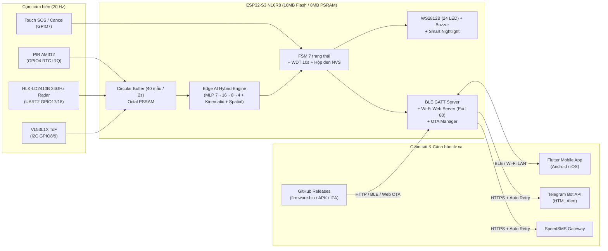
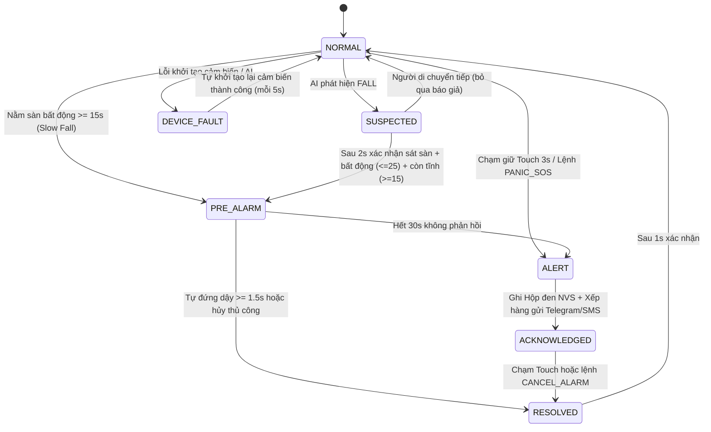

# FallDetection_S3R8 (Fall Guard S3R8)

Hệ thống giám sát và phát hiện té ngã không tiếp xúc (non-contact, bảo vệ quyền riêng tư không dùng camera) chạy trên **ESP32-S3 N16R8** (16MB Flash, 8MB Octal PSRAM), kết hợp cảm biến đa phương thức (**ToF VL53L1X + 24GHz FMCW Radar HLK-LD2410B + PIR AM312**), bộ suy luận **Edge AI lai đa tiêu chí** và ứng dụng di động đa nền tảng **Flutter (Android & iOS)**.

> **Phiên bản hiện tại:** Firmware `Pre-release2.0.1` · Mobile App **Hearth** `Pre-release2.0.1` (`2.0.1+1`) · Target MCU: `esp32-s3-devkitc-1` (`qio_opi`)

---

## Mục lục

- [Tổng quan kiến trúc](#tổng-quan-kiến-trúc)
- [Tính năng nổi bật](#tính-năng-nổi-bật)
- [Cấu trúc thư mục](#cấu-trúc-thư-mục)
- [Phần cứng & Sơ đồ nối chân](#phần-cứng--sơ-đồ-nối-chân)
- [Thuật toán Edge AI & Máy trạng thái (FSM)](#thuật-toán-edge-ai--máy-trạng-thái-fsm)
- [Hướng dẫn Build & Cài đặt](#hướng-dẫn-build--cài-đặt)
- [Giao tiếp BLE, REST API & Lệnh điều khiển](#giao-tiếp-ble-rest-api--lệnh-điều-khiển)
- [Cập nhật Firmware OTA](#cập-nhật-firmware-ota)
- [CI/CD & Tự động phát hành](#cicd--tự-động-phát-hành)
- [Xử lý sự cố thường gặp](#xử-lý-sự-cố-thường-gặp)

---

## Tổng quan kiến trúc



---

## Tính năng nổi bật

### 1. Firmware ESP32-S3 (`src/`)
- **Cảm biến đa phương thức & tự phục hồi lỗi:**
  - **VL53L1X (ToF):** Đo khoảng cách/chiều cao cơ thể qua I2C `100 kHz` (địa chỉ `0x29`, chế độ `Medium`, timing budget `40 ms`), tự giải phóng bus I2C bằng 9 xung clock nếu đường SDA bị treo `LOW` và tự khởi tạo lại khi mất dữ liệu.
  - **HLK-LD2410B (Radar mmWave 24GHz):** Tự động dò tốc độ baud (`256000` ↔ `115200`), bật **Engineering Mode** thu 9 cổng năng lượng chuyển động (va chạm) và 9 cổng năng lượng tĩnh (hô hấp/hiện diện).
  - **PIR AM312:** Phát hiện chuyển động hồng ngoại qua ngắt ngoài GPIO4 (có thể bật/tắt bằng macro `ENABLE_PIR_SENSOR`).
  - **Bộ đệm trượt Octal PSRAM:** Lấy mẫu `20 Hz` (chu kỳ `50 ms`), lưu cửa sổ trượt `40` mẫu (`2.0 s`) trực tiếp trên PSRAM ngoài (`MALLOC_CAP_SPIRAM`).
- **Phát hiện 3 kịch bản khẩn cấp:**
  1. **Té ngã va chạm mạnh (`EVENT_FALL_IMPACT`):** Kết hợp tốc độ sụt giảm chiều cao ToF, đỉnh động năng Radar và khoảng cách sát sàn, sau đó xác minh bất động `2 s` kèm tín hiệu tĩnh hô hấp.
  2. **Ngã chậm / Ngất lịm (`EVENT_SLOW_FALL`):** Nằm sát sàn (`<= floorThresholdMm`), ít chuyển động nhưng còn tín hiệu hiện diện/hô hấp kéo dài quá `15 s`.
  3. **SOS thủ công (`EVENT_MANUAL_SOS`):** Chạm giữ cảm biến touch (GPIO7) trong `3 s` hoặc kích hoạt lệnh `PANIC_SOS` từ xa.
- **Giảm báo động giả & tự giải trừ:**
  - Lọc phân biệt hành động ngồi xuống ghế (*SIT Rejection*).
  - Cảnh báo tại chỗ tầng 1 (`PRE_ALARM`) kéo dài `30 s` cho phép người dùng chạm nút hủy hoặc **tự đứng dậy vững vàng trong `1.5 s`** để hệ thống tự hủy cảnh báo.
- **Hoạt động độc lập khi không có điện thoại ở gần:**
  - Tự gửi cảnh báo trực tiếp qua **Telegram Bot API** (hỗ trợ nhiều Chat ID/Group ID phân tách bằng `,` hoặc `;`) và **SMS Gateway (SpeedSMS)** (hỗ trợ nhiều số điện thoại).
  - Nếu Wi-Fi bị gián đoạn đúng lúc có sự cố, firmware tự giữ hàng đợi và gửi lại định kỳ (`10 s` khi chờ Wi-Fi, `30 s` khi lỗi HTTP) cho tới khi thành công.
- **Tiện ích bổ trợ & An toàn hệ thống:**
  - **Đèn ngủ thông minh (Smart Nightlight):** Tự bật ánh sáng vàng ấm `40 s` trên dải LED WS2812B khi phát hiện di chuyển trong khung giờ hẹn lịch (mặc định `18:00 – 06:00`, đồng bộ giờ qua NTP `UTC+7`).
  - **Còi báo động chống tự kêu lúc boot:** Ngắt phần cứng ngay microgiây đầu tiên (`earlyHardwareMute()`), hỗ trợ đổi phân cực **Active-LOW / Active-HIGH** và **Mute/Unmute** lưu bền vững trong NVS Flash.
  - **Hộp đen NVS Flash:** Lưu vòng tròn 5 sự kiện té ngã gần nhất (loại sự kiện, uptime, tốc độ rơi, đỉnh động năng, cự ly radar).
  - **Hardware Watchdog Timer (`10 s`):** Tự reset nếu hệ thống treo.

### 2. Ứng dụng di động Flutter (`mobile_app/`)
- **Đa nền tảng Android & iOS**, giao diện Material 3 hỗ trợ chế độ Sáng/Tối theo hệ thống.
- **Kết nối kép BLE & Wi-Fi Direct LAN:** Quét thiết bị `FallDetector_S3R8`, cấu hình Wi-Fi, danh bạ cứu hộ (SĐT, Telegram Bot Token, Chat ID), ngưỡng sàn `floor_mm`, lịch đèn ngủ và phân cực/tắt tiếng còi.
- **Giám sát thời gian thực:** Hiển thị trạng thái FSM, phân loại tư thế AI + độ tin cậy, biểu đồ telemetry (`LiveTelemetryChart`), mô phỏng tư thế người (`HumanPostureSimulation`), và Hộp đen lịch sử sự cố.
- **Bộ công cụ chăm sóc & y tế cho người cao tuổi:**
  - Hướng dẫn sơ cứu trực quan từng bước (`FirstAidGuideDialog`).
  - Hồ sơ y tế khẩn cấp & Thẻ Medical ID (`ElderlyMedicalProfile`, `EmergencyMedicalIdCardDialog`).
  - Đánh giá nguy cơ té ngã theo chuẩn **CDC STEADI** (`CdcSteadiAssessmentDialog`).
  - Xuất/xem Báo cáo kiểm tra y tế (`MedicalAuditReportDialog`) & hộp thoại báo động khẩn cấp toàn màn hình (`CriticalEmergencyAlarmDialog`).
- **Cập nhật In-App OTA:** Tự kiểm tra bản phát hành mới nhất từ GitHub Releases cho cả ứng dụng lẫn firmware ESP32.

---

## Cấu trúc thư mục

```text
FallDetection_S3R8/
├── platformio.ini                 # Cấu hình PlatformIO cho ESP32-S3 N16R8 (16MB Flash, OPI PSRAM)
├── HARDWARE_PINOUT.md             # Chi tiết sơ đồ đấu nối & lưu ý cấp nguồn 5V
├── src/
│   ├── config.h                   # Pinout, ngưỡng động học, hằng số thời gian, enum FSM/AI
│   ├── main.cpp                   # Setup/Loop, FSM 7 trạng thái, xử lý lệnh BLE/HTTP/Serial & retry SOS
│   ├── sensors.h / sensors.cpp    # Driver VL53L1X, parser LD2410B auto-baud, PIR ISR, circular buffer PSRAM
│   ├── edge_ai.h / edge_ai.cpp    # Mạng MLP (7-16-8-4) + chấm điểm động học/không gian (Hybrid Fusion)
│   ├── model_data.h               # Dữ liệu tham chiếu mô hình INT8 (TFLM)
│   ├── alert_system.h / .cpp      # Điều khiển WS2812B, Buzzer patterns, Nightlight, Wi-Fi, Telegram & SMS
│   ├── ble_provision.h / .cpp     # BLE GATT Server (6 characteristics), NVS config & Hộp đen 5 sự kiện
│   ├── web_server.h / .cpp        # HTTP Server cổng 80 (REST API + trang Web OTA /update)
│   └── ota_manager.h / .cpp       # Quản lý HTTP/HTTPS OTA và BLE OTA chunk stream
├── alert_bot/                     # Bot cảnh báo đa kênh (Telegram tương tác + SMS + CallMeBot/Twilio Voice)
│   ├── server.py                  # FastAPI REST API + Webhook nhận sự kiện ngã (/api/alerts/fall)
│   ├── dispatcher.py              # Phát cảnh báo đồng thời / leo thang tuần tự + xác nhận/đóng sự cố
│   ├── telegram_poller.py         # Telegram Bot (/start, /register, /settings, /contacts, /test, nút bấm)
│   ├── providers/                 # Telegram Bot API, SpeedSMS VN, Twilio SMS/Voice, CallMeBot Telegram Call
│   └── tests/                     # Unit & integration tests (pytest)
├── mobile_app/                    # Ứng dụng Flutter (Android & iOS)
│   ├── pubspec.yaml               # Dependencies: flutter_blue_plus, url_launcher, shared_preferences, ...
│   ├── README.md                  # Tài liệu riêng cho ứng dụng di động
│   └── lib/
│       ├── main.dart              # Entrypoint, Theme Material 3 & khai báo BLE UUID
│       ├── startup.dart           # Cổng xin quyền Bluetooth/Nearby Devices khi khởi động
│       ├── dashboard.dart         # Màn hình quét, kết nối & tổng quan thiết bị
│       ├── device_detail.dart     # Bảng điều khiển chi tiết, cấu hình thiết bị, OTA & Hộp đen
│       ├── telemetry_widgets.dart # Biểu đồ telemetry & mô phỏng tư thế người
│       ├── settings.dart          # Cài đặt chung, đơn vị đo & kiểm tra cập nhật GitHub Release
│       └── dialogs.dart           # Sơ cứu, Hồ sơ y tế, CDC STEADI, báo cáo y tế & cảnh báo SOS
├── ios_ota/
│   └── manifest.plist             # Manifest cài đặt OTA cho iOS
├── scripts/
│   └── pull_artifacts.py          # Script Python tải tự động APK/IPA/Firmware từ GitHub Actions
└── .github/workflows/
    └── build_apps.yml             # CI/CD build Android APK, iOS IPA, ESP32 firmware & publish Release
```

---

## Phần cứng & Sơ đồ nối chân

### Danh sách linh kiện chính
- **Vi điều khiển:** ESP32-S3 N16R8 DevKitC-1 (16MB QIO Flash, 8MB Octal OPI PSRAM).
- **Cảm biến khoảng cách:** ToF Laser **VL53L1X** (I2C, 3.3V).
- **Radar sóng milimet:** **HLK-LD2410B** 24GHz FMCW (UART, 5V).
- **Cảm biến hồng ngoại:** **PIR AM312** (3.3V).
- **Nút cảm ứng:** Module Touch (Active-HIGH, 3.3V).
- **Đầu ra báo động:** Thanh/vòng LED **WS2812B** (24 LED, 5V) + **Active Buzzer 5V** (kèm mạch driver transistor/MOSFET).

### Bảng nối chân (Pinout)

> **Cảnh báo:** Tuyệt đối không sử dụng **GPIO33 – GPIO37** trên ESP32-S3 N16R8 vì dành riêng cho Octal PSRAM/OPI Flash, và không nối nút cảm ứng vào **GPIO0** (chân BOOT).

| Module / Thiết bị | Chân ESP32-S3 | Giao tiếp / Ghi chú |
| :--- | :---: | :--- |
| **PIR AM312 OUT** | `GPIO4` | Ngắt ngoài RTC (`RISING`), nguồn 3.3V |
| **Buzzer Module IN** | `GPIO5` | Mặc định Active-LOW (đổi được qua BLE/Serial); dùng mạch driver, không kéo tải trực tiếp |
| **WS2812B DIN** | `GPIO6` | 24 LED RGB, độ sáng mặc định `100/255`, cấp nguồn 5V riêng, chung GND |
| **Touch Module OUT** | `GPIO7` | Active-HIGH (`INPUT_PULLDOWN`): chạm ngắn hủy báo động, chạm giữ `3 s` kích SOS |
| **VL53L1X SDA** | `GPIO8` | I2C `100 kHz`, địa chỉ `0x29`, logic 3.3V |
| **VL53L1X SCL** | `GPIO9` | I2C `100 kHz`, logic 3.3V |
| **LD2410B RX** | `GPIO17` | `Serial2 TX` (ESP32 TX → Radar RX) |
| **LD2410B TX** | `GPIO18` | `Serial2 RX` (Radar TX → ESP32 RX, `INPUT_PULLUP`) |

### Lưu ý cấp nguồn
- Dùng nguồn **5V ổn định tối thiểu 2A** (khuyến nghị **3A** khi bật toàn bộ 24 LED WS2812B), đấu vào chân `5V/VBUS` (không cấp nguồn ngoài vào chân `3V3`).
- Nối chung **GND** cho ESP32-S3 và toàn bộ cảm biến/LED; nên đặt tụ lọc `470–1000 µF` gần dải LED WS2812B để tránh sụt áp gây mất BLE khi khởi động.
- Xem chi tiết thêm tại [HARDWARE_PINOUT.md](HARDWARE_PINOUT.md).

---

## Thuật toán Edge AI & Máy trạng thái (FSM)

### 7 đặc trưng đầu vào (cửa sổ trượt 2.0 giây)
1. `f[0]` – `maxMotion`: Đỉnh năng lượng chuyển động Radar LD2410 (`0–100`).
2. `f[1]` – `maxStatic`: Đỉnh năng lượng tĩnh / hô hấp Radar LD2410 (`0–100`).
3. `f[2..4]` – `tofHigh`, `tofMid`, `tofLow`: Cự ly đo ToF mới nhất (`mm`).
4. `f[5]` – `dropRate`: Tốc độ sụt giảm chiều cao trung bình giữa 5 mẫu đầu và 5 mẫu cuối cửa sổ (`mm/s`).
5. `f[6]` – `radarDist`: Khoảng cách tới mục tiêu từ Radar (`cm`).

### Công thức kết hợp lai (Hybrid Fusion)
$$\text{finalFallConf} = 0.25 \times P_{\text{MLP}}(\text{FALL}) + 0.45 \times S_{\text{kinematic}} + 0.30 \times S_{\text{spatial}}$$

- **Ngưỡng chính trong `src/config.h`:**
  - `FALL_VELOCITY_THRESH_MM_S = 550 mm/s` (`STRONG = 700 mm/s`)
  - `FALL_RADAR_MOTION_THRESH = 40/100` (`STRONG = 70/100`)
  - `FLOOR_HEIGHT_DEFAULT_MM = 450 mm` · `SIT_HEIGHT_MIN_MM = 480 mm` · `STAND_HEIGHT_MIN_MM = 900 mm`
- Chỉ xác nhận `CLASS_FALL` khi `finalFallConf >= 0.62` **và** thỏa tối thiểu 2 dấu hiệu đồng thời: `(velTrig && impTrig)` hoặc `(strongVelocity && floorTrig)` hoặc `(strongImpact && floorTrig)`.

### Luồng chuyển trạng thái FSM



### Quy ước màu đèn LED trạng thái
| Trạng thái | LED WS2812B | Còi Buzzer |
| :--- | :--- | :--- |
| Khởi động (`setup`) | Tím Magenta | Tắt (mặc định `ENABLE_STARTUP_BEEP = 0`) |
| `STATE_NORMAL` | Xanh lá (`#00FF00`) / Vàng ấm khi bật Nightlight | Im lặng |
| `STATE_SUSPECTED` | Vàng tối (`#332200`) | Im lặng |
| `STATE_PRE_ALARM` | Nhấp nháy Cam (`#FFA500`, chu kỳ 250ms) | Bíp đôi định kỳ (`BUZZER_PRE_ALARM_PULSE`) |
| `STATE_ALERT` | Đỏ (`#FF0000`) | Còi hú dồn dập (`BUZZER_ALERT_SIREN`) |
| `STATE_ACKNOWLEDGED` | Nhấp nháy Đỏ (`#FF0000`, chu kỳ 500ms) | Tắt để tránh hoảng loạn |
| `STATE_DEVICE_FAULT` | Nhấp nháy Tím (`#9600FF`, chu kỳ 200ms) | Im lặng |
| Đang nạp OTA HTTP | Tím đậm (`#800080`) | Im lặng |

---

## Hướng dẫn Build & Cài đặt

### 1. Firmware ESP32-S3 (PlatformIO)

**Yêu cầu:** [PlatformIO Core (CLI)](https://platformio.org/) hoặc VS Code kèm extension PlatformIO IDE.

```bash
# Build firmware
pio run -e esp32-s3-n16r8

# Nạp firmware vào mạch ESP32-S3 N16R8
pio run -e esp32-s3-n16r8 --target upload

# Mở Serial Monitor (115200 baud)
pio device monitor -b 115200
```

> **Lưu ý cấu hình SMS Gateway:** Trước khi dùng tính năng gửi SMS qua SpeedSMS, cập nhật `DEFAULT_SMS_TOKEN` (và `DEFAULT_SMS_GATEWAY_URL` nếu đổi nhà cung cấp) trong `src/config.h`. Thông tin Wi-Fi, Telegram Bot Token, Chat ID và SĐT nhận tin có thể cấu hình trực tiếp từ Mobile App qua BLE mà không cần biên dịch lại.

**Phím tắt debug nhanh trên Serial Monitor (`115200 baud`):**
- `T` – Phát tiếng bíp test còi (`200 ms`)
- `H` – Chuyển còi sang chế độ `Active-HIGH` (lưu vào NVS)
- `L` – Chuyển còi sang chế độ `Active-LOW` (lưu vào NVS)
- `M` – Bật / tắt chế độ im lặng (`Mute`)
- `S` – In trạng thái FSM, pattern còi, phân cực và giá trị chân GPIO5

### 2. Mobile App (Flutter)

**Yêu cầu:** Flutter SDK (kèm Dart SDK `^3.11.5`), Android Studio (cho Android) hoặc macOS + Xcode (cho iOS).

```bash
cd mobile_app
flutter pub get

# Chạy trực tiếp trên thiết bị thật
flutter run

# Build Android Release APK
flutter build apk --release
# Output: mobile_app/build/app/outputs/flutter-apk/app-release.apk

# Build iOS (cần macOS + Xcode)
flutter build ipa
```

---

## Giao tiếp BLE, REST API & Lệnh điều khiển

### 1. BLE GATT Profile (`FallDetector_S3R8`, MTU 512)

- **Service UUID:** `4fafc201-1fb5-459e-8fcc-c5c9c331914b`

| Characteristic | UUID | Thuộc tính | Định dạng / Chức năng |
| :--- | :--- | :--- | :--- |
| **Wi-Fi Config** | `0beb5483-e18e-4f36-9e1b-b4d6b63c7b28` | `WRITE` | `{"ssid":"...","pass":"..."}` → Lưu NVS và tự reboot |
| **Contact & Floor** | `1c6f8742-9a6d-4785-b9e1-e63f9b8c0011` | `READ`, `WRITE` | `{"phone":"...","chat_id":"...","bot_token":"...","floor_mm":450}` |
| **Status** | `2d8a9e22-7f1c-4b53-8d2a-f58c7e9a3344` | `READ`, `NOTIFY` | Chuỗi trạng thái (`CONNECTED_IP:...`, `OTA_PROGRESS:50`, `REMOTE_ALERT_SENT`, ...) |
| **Telemetry** | `3e9baf33-8a2d-4c64-9e3b-a69d8f0b4455` | `READ`, `NOTIFY` | Notify mỗi `250 ms`: `{"st":"NORMAL","cls":"STAND","cf":0.92,"h":1200,"m":12,"s":20,"dr":0,"pir":0,"ip":"...","rssi":-55,"uptime":120,"ver":"v2.0.0"}` |
| **Command** | `4fa0b044-9b3e-4d75-af4c-b70e901c5566` | `WRITE` | Gửi lệnh điều khiển dạng văn bản thuần (xem bảng dưới) |
| **BLE OTA** | `5fa0b055-9b3e-4d75-af4c-b70e901c5566` | `WRITE`, `WRITE_NR` | `OTA_BEGIN:<bytes>`, binary chunks, `OTA_END`, `OTA_ABORT` |

### 2. Wi-Fi LAN HTTP REST API (Cổng 80)

Khi ESP32 kết nối Wi-Fi thành công, Web Server tự động chạy tại `http://<ESP32_IP>/` (hỗ trợ đầy đủ CORS):

| Method | Endpoint | Mô tả |
| :--- | :--- | :--- |
| `GET` | `/` | Trang giới thiệu các API có sẵn |
| `GET` | `/api/telemetry` (hoặc `/telemetry`) | JSON telemetry thời gian thực (cùng định dạng với BLE) |
| `GET` | `/api/events` (hoặc `/events`) | JSON lịch sử 5 sự kiện trong Hộp đen NVS Flash |
| `GET` | `/api/status` | JSON thông số phần cứng, trạng thái Wi-Fi, `free_heap`, `floor_mm`, cấu hình còi, trạng thái gửi SOS |
| `GET` / `POST` | `/api/command` | Thực thi lệnh qua query `?cmd=<CMD>` hoặc body JSON `{"cmd":"<CMD>"}` |
| `GET` / `POST` | `/api/config` | Đọc / đồng bộ danh bạ cứu hộ, Telegram, CallMeBot, URL Alert Bot & channel mask qua Wi-Fi LAN |
| `GET` / `POST` | `/update` | Trang Web OTA upload trực tiếp file `firmware.bin` |

### 3. Danh sách lệnh điều khiển (`CHAR_CMD_UUID` & `/api/command`)

| Lệnh | Tác dụng |
| :--- | :--- |
| `CALIBRATE_FLOOR` | Hiệu chuẩn ngưỡng sàn từ khoảng cách ToF hiện tại và lưu NVS |
| `CANCEL_ALARM` | Hủy cảnh báo/SOS, tắt còi, reset trạng thái về `NORMAL` |
| `PANIC_SOS` | Kích hoạt cảnh báo khẩn cấp SOS từ xa ngay lập tức |
| `TEST_ALARM` / `TEST_BEEP` | Kiểm tra còi + LED đỏ (`400 ms`) hoặc bíp ngắn (`200 ms`) |
| `TEST_REMOTE_ALERT` | Gửi thử cảnh báo ngã qua Alert Bot Server (hoặc fallback trực tiếp Telegram / SMS / CallMeBot) |
| `GET_HISTORY` / `CLEAR_HISTORY` / `ADD_TEST_EVENT` | Đọc, xóa hoặc thêm sự kiện giả lập vào Hộp đen NVS |
| `BUZZER_ACTIVE_LOW` / `BUZZER_ACTIVE_HIGH` | Đổi phân cực còi và lưu vĩnh viễn vào NVS |
| `BUZZER_MUTE` / `BUZZER_UNMUTE` | Tắt/mở tiếng còi hoàn toàn (phục vụ test lab yên tĩnh) |
| `NIGHTLIGHT_SCHEDULE:<en>,<sh>,<sm>,<eh>,<em>` | Cài lịch bật đèn ngủ (VD: `NIGHTLIGHT_SCHEDULE:1,18,0,6,0`) |
| `OTA_LATEST` / `OTA_HTTP:<url>` | Tải và nạp firmware trực tiếp qua Wi-Fi HTTPS/HTTP |
| `GET_VERSION` | Trả về phiên bản firmware hiện tại qua Status Notify |
| `REBOOT` | Khởi động lại ESP32-S3 |
| `RESET_NETWORK` | Xóa SSID/Password Wi-Fi đã lưu và khởi động lại |
| `FACTORY_RESET` | Xóa toàn bộ NVS Flash về mặc định xuất xưởng và khởi động lại |

---

## Cập nhật Firmware OTA

Thiết bị hỗ trợ **3 phương thức nâng cấp Firmware không dây**:

1. **HTTPS OTA qua GitHub Releases (Khuyên dùng):**
   - Gửi lệnh `OTA_LATEST` (hoặc `OTA_HTTP:<custom_url>`) qua BLE hoặc `/api/command`.
   - ESP32 tự tải `firmware.bin` từ release `latest` trên GitHub, gửi tiến độ `OTA_PROGRESS:<0..100>` về App và tự khởi động lại.
2. **Web OTA trong mạng LAN:**
   - Mở trình duyệt tới `http://<ESP32_IP>/update`, chọn file `.pio/build/esp32-s3-n16r8/firmware.bin` và bấm nạp.
3. **BLE OTA (Không cần Wi-Fi):**
   - App gửi `OTA_BEGIN:<fileSize>` vào `CHAR_OTA_UUID`, truyền liên tiếp các chunk nhị phân, sau đó gửi `OTA_END` để xác thực và reboot.

---

## CI/CD & Tự động phát hành

Workflow `.github/workflows/build_apps.yml` tự động chạy khi push lên `main`/`master`, gắn tag `v*`, mở PR hoặc kích hoạt thủ công (`workflow_dispatch`):

1. **`prepare-version`:** Tự động tính Semantic Version và lọc phát hành thông minh:
   - **Không tăng version (cập nhật lại asset trong Release hiện tại)** khi chỉ sửa tài liệu/CI/test/cấu hình (`README.md`, `CHANGELOG.md`, `.github/workflows/*`, `scripts/*`, `analysis_options.yaml`, `mobile_app/test/*`) hoặc khi commit bắt đầu bằng `ci:`, `docs:`, `chore:`, `test:`, `style:`, `build:`, `refactor:` hoặc chứa `[no-release]` / `[skip release]`. Các tệp APK/IPA/firmware mới dựng vẫn tự động thay thế tệp cũ trong Release hiện tại (không tạo trùng lặp).
   - **Tự động tăng version & tạo Release mới** khi có thay đổi mã app/firmware (`src/`, `mobile_app/lib/`, `platformio.ini`, ...) theo mức `[major]` / `breaking change`, `[minor]` / `feat:`, mặc định `patch`, hoặc khi có từ khóa `[release]`, push tag `v*`, hay chạy thủ công `workflow_dispatch`.
2. **`build-android`:** Chạy `flutter analyze --no-fatal-infos`, `flutter test` và build Release APK (`Hearth-Android-v<ver>-build-<num>.apk`).
3. **`build-ios`:** Chạy trên `macos-latest`, đóng gói bản `-unsigned.ipa` (và tự động ký số `-signed.ipa` vào Artifacts riêng nếu đã khai báo secrets `APPLE_CERT_P12_BASE64`, `APPLE_CERT_PASSWORD`, `APPLE_PROVISION_PROFILE_BASE64`).
4. **`build-firmware`:** Chạy `pio run -e esp32-s3-n16r8` tạo `firmware.bin`.
5. **`publish-release`:** Chỉ chạy khi `should_release == 'true'`; tự động sinh Release Notes chi tiết từ `CHANGELOG.md` + git commits kèm bảng SHA-256 và phát hành 1 Release chính thức duy nhất (`v<ver>`, `make_latest: true`).

### Tải nhanh Artifacts từ GitHub Actions về máy
```bash
# Tải artifacts từ lần build thành công gần nhất
python scripts/pull_artifacts.py

# Hoặc chờ workflow đang chạy hoàn tất rồi tự động tải về
python scripts/pull_artifacts.py --wait
```

---

## Xử lý sự cố thường gặp

- **Cắm USB chạy bình thường nhưng cấp nguồn ngoài 5V mất BLE:** Thường do sụt áp đường `3V3` (< `3.1V`) khi 24 LED WS2812B khởi động, thiếu GND chung hoặc chân `GPIO0` bị kéo `LOW`. Đo lại nguồn 5V/3V3 khi khởi động, dùng nguồn 5V 2A–3A và gắn tụ `470–1000 µF` gần LED.
- **Không thấy Octal PSRAM trên Serial Monitor:** Kiểm tra cấu hình `board_build.arduino.memory_type = qio_opi` và `-DBOARD_HAS_PSRAM` trong `platformio.ini`.
- **Còi tự kêu liên tục khi mới cấp nguồn:** Kiểm tra phân cực module còi; gửi lệnh `BUZZER_ACTIVE_HIGH` hoặc `BUZZER_ACTIVE_LOW` (qua App hoặc nhấn `H`/`L` trên Serial Monitor) để khớp với phần cứng.
- **ToF VL53L1X báo lỗi `STATE_DEVICE_FAULT`:** Kiểm tra dây `SDA (GPIO8)` / `SCL (GPIO9)` và nguồn `3.3V`; firmware sẽ tự thử khôi phục I2C và khởi tạo lại mỗi `5 giây`.
