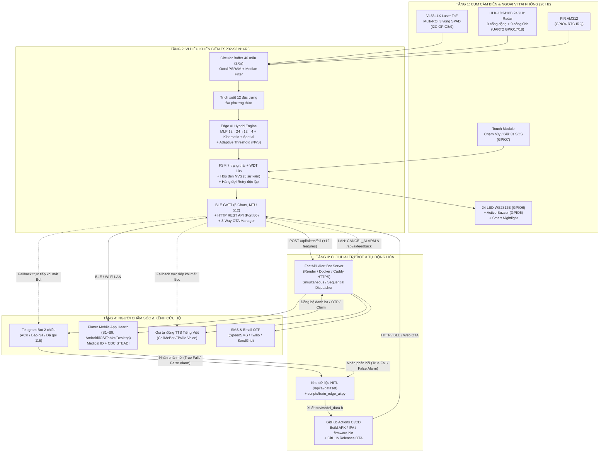
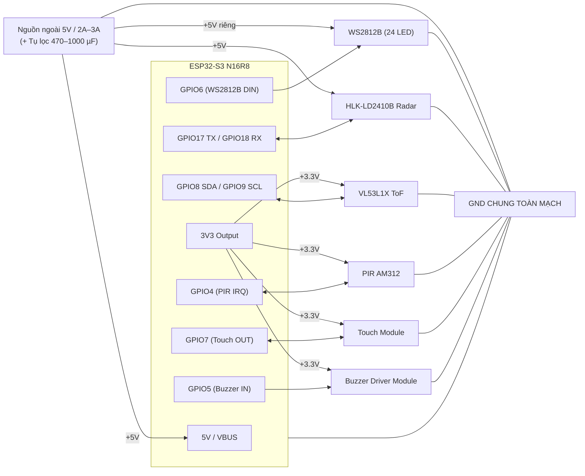
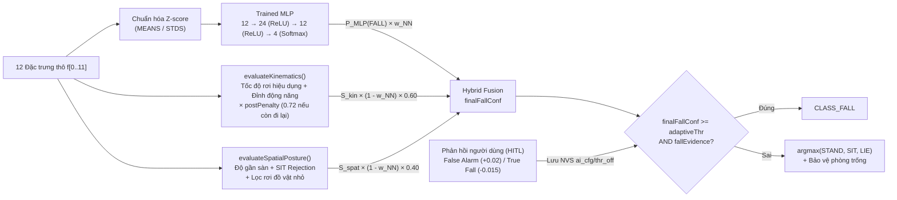
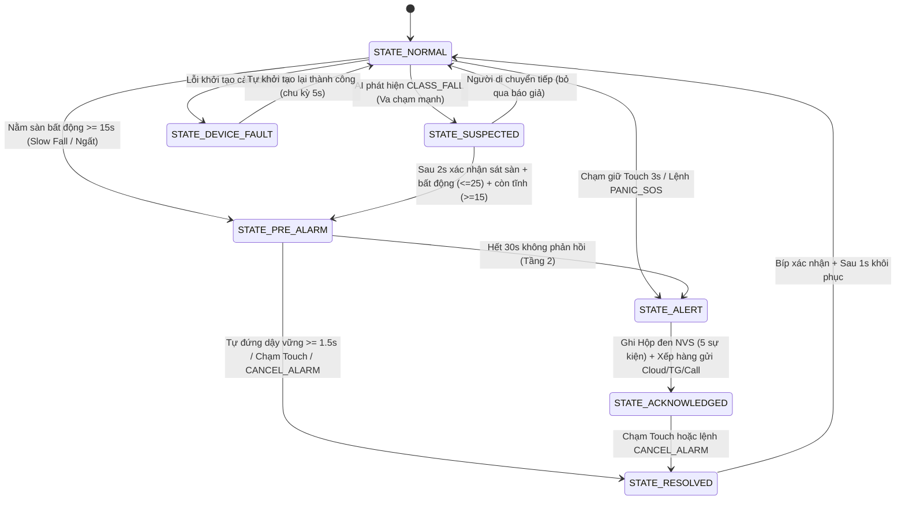
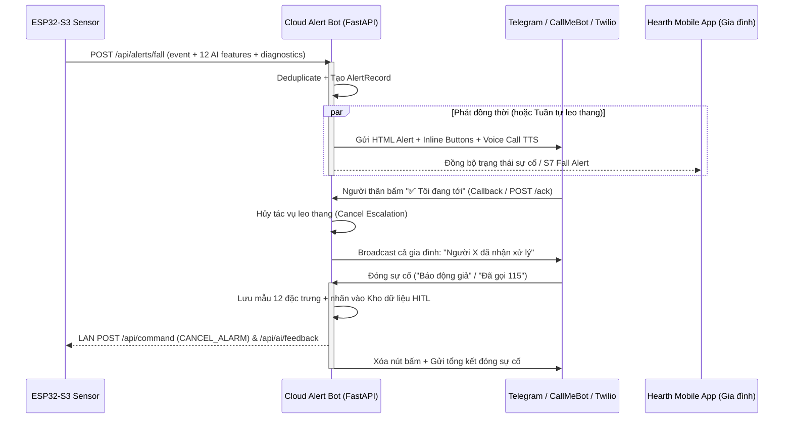
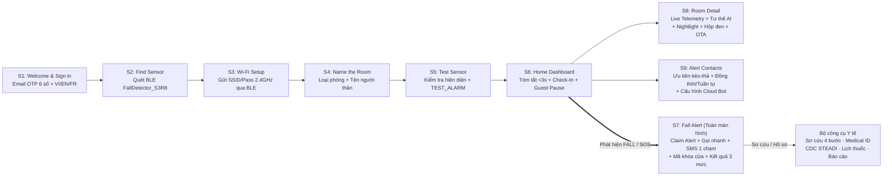
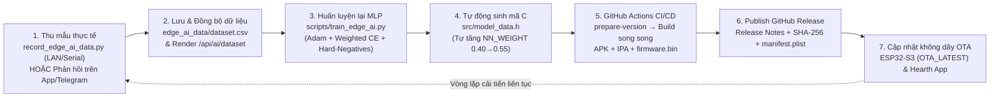

<!-- Báo cáo Đồ án - Chuẩn trình bày HUST (Đại học Bách khoa Hà Nội) -->

# LỜI CẢM ƠN

Để hoàn thành đồ án này, em xin gửi lời cảm ơn tới thầy/cô **[Học hàm, học vị – Họ và tên GVHD]** đã trực tiếp hướng dẫn, định hướng đề tài và góp ý trong suốt quá trình thiết kế mạch, xử lý thuật toán và hoàn thiện báo cáo.

Em cũng xin cảm ơn các thầy cô tại **Trường Điện - Điện tử, Đại học Bách khoa Hà Nội** đã giảng dạy và trang bị những kiến thức nền tảng về vi điều khiển, hệ thống nhúng, xử lý tín hiệu và mạng truyền thông giúp em có cơ sở triển khai hệ thống thực tế.

Cuối cùng, em cảm ơn gia đình và bạn bè đã hỗ trợ, đóng góp ý kiến và tham gia thử nghiệm các kịch bản hoạt động của thiết bị. Do giới hạn về thời gian và điều kiện đo đạc thực nghiệm, đồ án khó tránh khỏi còn những điểm cần hoàn thiện thêm; em rất mong nhận được nhận xét của quý thầy cô để tiếp tục cải tiến hệ thống.

*Hà Nội, tháng ... năm ...*  
**Sinh viên thực hiện**  
*(Ký và ghi rõ họ tên)*

---

# TÓM TẮT ĐỒ ÁN

Đồ án trình bày quá trình thiết kế và xây dựng hệ thống giám sát, phát hiện té ngã không tiếp xúc mang tên **Hearth (`FallDetection_S3R8`)**, hướng tới nhu cầu theo dõi an toàn cho người cao tuổi sống một mình trong không gian trong nhà mà không cần đeo thiết bị lên người và không sử dụng camera.

Phần cứng trung tâm sử dụng vi điều khiển **ESP32-S3 N16R8** (16 MB Flash, 8 MB Octal PSRAM) kết nối với ba loại cảm biến: cảm biến đo khoảng cách laser **VL53L1X** cấu hình quét 3 vùng độ cao (Multi-ROI), radar sóng milimet **24 GHz HLK-LD2410B** đọc 9 cổng năng lượng động/tĩnh và cảm biến hồng ngoại **PIR AM312**. Dữ liệu được lấy mẫu ở tần số `20 Hz` vào bộ đệm vòng 40 mẫu (`2 giây`) trên PSRAM để trích xuất 12 đặc trưng đầu vào cho bộ phân loại kết hợp giữa mạng nơ-ron MLP (`12 → 24 → 12 → 4`) và các điều kiện ràng buộc động học – không gian. Một máy trạng thái 7 trạng thái được cài đặt để xác minh bất động sau va chạm, phát hiện nằm sàn kéo dài trên `15 giây`, cho phép tự hủy khi người dùng tự đứng dậy và gửi cảnh báo độc lập qua Wi-Fi.

Phía phần mềm gồm dịch vụ nhận và điều phối cảnh báo viết bằng **FastAPI** (`alert_bot/`) hỗ trợ nhắn tin Telegram 2 chiều, gọi thoại tự động (CallMeBot/Twilio) và SMS, cùng ứng dụng di động **Flutter** (`mobile_app/`) dùng để cấu hình mạch qua BLE/Wi-Fi, theo dõi thông số cảm biến theo thời gian thực và ghi nhận phản hồi báo động giả phục vụ huấn luyện lại mô hình. Các kiểm thử đơn vị ở tầng máy chủ đạt `12/12` ca vượt qua, firmware biên dịch gọn trong `1.576 KB` Flash và mô hình MLP khởi tạo đạt `99,72%` độ chính xác trên tập dữ liệu mô phỏng vật lý `1.800` mẫu.

---

# DANH MỤC CÁC CHỮ VIẾT TẮT

| Chữ viết tắt | Tiếng Anh | Giải thích |
| :--- | :--- | :--- |
| **ADL** | Activities of Daily Living | Các hoạt động sinh hoạt hằng ngày |
| **API** | Application Programming Interface | Giao diện lập trình ứng dụng |
| **BLE** | Bluetooth Low Energy | Bluetooth năng lượng thấp |
| **CI/CD** | Continuous Integration / Delivery | Tích hợp và phát hành tự động |
| **FAR** | False Alarm Rate | Tỷ lệ báo động giả |
| **FMCW** | Frequency-Modulated Continuous Wave | Sóng liên tục điều biến tần số |
| **FSM** | Finite State Machine | Máy trạng thái hữu hạn |
| **GATT** | Generic Attribute Profile | Cấu trúc dịch vụ/đặc tính của BLE |
| **GPIO** | General-Purpose Input/Output | Chân vào/ra đa dụng |
| **HITL** | Human-in-the-Loop | Cập nhật mô hình có phản hồi người dùng |
| **I2C** | Inter-Integrated Circuit | Giao tiếp nối tiếp 2 dây (SDA, SCL) |
| **ISR** | Interrupt Service Routine | Hàm xử lý ngắt |
| **MLP** | Multi-Layer Perceptron | Mạng nơ-ron đa tầng |
| **mmWave** | Millimeter Wave | Sóng milimet (băng tần 24 GHz) |
| **MTU** | Maximum Transmission Unit | Kích thước gói truyền tối đa |
| **NTP** | Network Time Protocol | Giao thức đồng bộ giờ qua mạng |
| **NVS** | Non-Volatile Storage | Vùng nhớ lưu cấu hình trên Flash ESP32 |
| **OTA** | Over-The-Air | Nạp/cập nhật firmware không dây |
| **OTP** | One-Time Password | Mã xác thực dùng một lần |
| **PIR** | Passive Infrared | Cảm biến hồng ngoại thụ động |
| **PSRAM** | Pseudo Static RAM | Bộ nhớ RAM ngoài mở rộng |
| **ROI** | Region of Interest | Vùng quét trên mảng diode SPAD |
| **ToF** | Time-of-Flight | Đo khoảng cách theo thời gian bay tia sáng |
| **UART** | Universal Asynchronous Receiver-Transmitter | Giao tiếp nối tiếp bất đồng bộ |
| **WDT** | Watchdog Timer | Bộ định thời giám sát chống treo chip |

---

# DANH MỤC CÁC HÌNH VẼ VÀ SƠ ĐỒ

- **Hình 3.1:** Sơ đồ kiến trúc tổng thể 4 tầng của hệ thống `FallDetection_S3R8`.
- **Hình 3.2:** Sơ đồ đấu nối phần cứng và phân phối nguồn 5V/3,3V trên ESP32-S3 N16R8.
- **Hình 3.3:** Luồng xử lý bộ suy luận Edge AI lai (MLP `12 → 24 → 12 → 4` kết hợp luật động học – không gian).
- **Hình 3.4:** Sơ đồ chuyển trạng thái FSM 7 trạng thái của firmware.
- **Hình 3.5:** Trình tự xử lý cảnh báo đa kênh, xác nhận sự cố và phản hồi về ESP32-S3.
- **Hình 3.6:** Sơ đồ luồng màn hình (`S1–S9`) của ứng dụng di động Hearth.
- **Hình 3.7:** Quy trình thu mẫu huấn luyện lại Edge AI và biên dịch phát hành OTA qua GitHub Actions.
- **Hình 4.1:** Ảnh chụp mô hình mạch phần cứng thực tế.
- **Hình 4.2:** Ảnh chụp giao diện ứng dụng Hearth trên điện thoại.
- **Hình 4.3:** Ảnh chụp thông báo Telegram 2 chiều và giao diện kiểm tra của máy chủ Alert Bot.

---

# DANH MỤC CÁC BẢNG BIỂU

- **Bảng 1.1:** So sánh các hướng tiếp cận phát hiện té ngã phổ biến hiện nay.
- **Bảng 2.1:** Thông số kỹ thuật cơ bản của vi điều khiển ESP32-S3 N16R8.
- **Bảng 3.1:** Danh sách linh kiện phần cứng chính sử dụng trong mô hình.
- **Bảng 3.2:** Sơ đồ phân bổ chân GPIO trên ESP32-S3 N16R8.
- **Bảng 3.3:** Chức năng các tệp mã nguồn trong thư mục firmware (`src/`).
- **Bảng 3.4:** Danh sách 12 đặc trưng đầu vào trích xuất trên cửa sổ trượt 2 giây.
- **Bảng 3.5:** Quy ước màu LED WS2812B và kiểu âm thanh Buzzer theo trạng thái FSM.
- **Bảng 3.6:** Bảng UUID các đặc tính BLE GATT của thiết bị `FallDetector_S3R8`.
- **Bảng 3.7:** Các đường dẫn REST API cổng 80 chạy trực tiếp trên ESP32-S3.
- **Bảng 3.8:** Các đường dẫn REST API chính của máy chủ `alert_bot`.
- **Bảng 3.9:** So sánh các kênh gửi cảnh báo tích hợp trong hệ thống.
- **Bảng 4.1:** Thống kê quy mô mã nguồn theo từng phân hệ.
- **Bảng 4.2:** Phân bố 1.800 mẫu dữ liệu mô phỏng vật lý dùng để huấn luyện khởi tạo.
- **Bảng 4.3:** Kết quả đánh giá mô hình `mlp12-v20261126-r0` trên tập kiểm định.
- **Bảng 4.4:** Kết quả chạy kiểm thử tự động bộ `pytest` cho máy chủ `alert_bot`.
- **Bảng 4.5:** Các ca kiểm thử giao diện Flutter trong `widget_test.dart`.
- **Bảng 4.6:** Bảng kịch bản và biểu mẫu ghi nhận kết quả đo thực nghiệm trên mạch thật.

---

# CHƯƠNG 1: TỔNG QUAN VỀ ĐỀ TÀI

## 1.1. Đặt vấn đề

Ở người cao tuổi, tai nạn té ngã trong sinh hoạt hằng ngày là nguyên nhân phổ biến dẫn tới chấn thương nặng như gãy xương đùi hoặc chấn thương vùng đầu. Theo số liệu của Tổ chức Y tế Thế giới (WHO), ước tính mỗi năm toàn cầu có khoảng `684.000` ca tử vong liên quan đến té ngã và khoảng `37,3` triệu trường hợp cần can thiệp y tế; nhóm người từ 65 tuổi trở lên chiếm tỷ lệ lớn nhất với xác suất gặp ít nhất một lần ngã mỗi năm vào khoảng `30%–40%`. Tại Việt Nam, cùng với tốc độ già hóa dân số và xu hướng con cái đi làm xa, số lượng người lớn tuổi ở nhà một mình vào ban ngày hoặc sống độc lập ngày càng tăng.

Trong thực tế, yếu tố làm tăng mức độ nguy hiểm không chỉ là lực va đập lúc ngã mà còn là khoảng thời gian nạn nhân nằm bất động mà không ai hay biết. Nếu được phát hiện và hỗ trợ sớm trong vài chục phút đầu, khả năng hồi phục sẽ cao hơn nhiều so với trường hợp nằm kéo dài nhiều giờ.

Khi khảo sát các sản phẩm hỗ trợ hiện có trên thị trường, có thể thấy hai nhóm giải pháp chính đều tồn tại những bất tiện rõ rệt trong quá trình sử dụng thực tế:

- **Thiết bị đeo (đồng hồ thông minh, dây đeo cổ có nút SOS, cảm biến gia tốc gắn thắt lưng):** Người lớn tuổi thường thấy vướng, hay quên đeo sau khi đi ngủ hoặc quên sạc pin định kỳ. Đặc biệt, khi vào nhà tắm — khu vực nền trơn dễ xảy ra trượt ngã nhất — người dùng hầu như luôn tháo đồng hồ hoặc vòng tay ra ngoài.
- **Camera giám sát tích hợp nhận dạng hình ảnh:** Dù không cần đeo trên người, việc lắp camera ghi hình liên tục trong phòng ngủ hoặc nhà vệ sinh vấp phải sự phản đối vì ảnh hưởng trực tiếp đến quyền riêng tư. Ngoài ra, chất lượng nhận diện của camera giảm mạnh vào ban đêm hoặc khi có hơi nước, vật che khuất.

Từ các hạn chế đó, đề tài đặt ra bài toán thiết kế một bộ cảm biến gắn cố định trong phòng, **không dùng camera** và **không yêu cầu đeo trên người**, có thể nhận biết cả tình huống ngã va chạm nhanh lẫn trường hợp ngất/trượt nằm bất động trên sàn, đồng thời tự phát cảnh báo qua mạng tới người thân ngay cả khi người chăm sóc không mở ứng dụng ở gần.

## 1.2. So sánh các hướng tiếp cận hiện nay

Trước khi chốt cấu hình phần cứng, nhóm nghiên cứu đối chiếu bốn hướng triển khai phổ biến dựa trên các tiêu chí sử dụng trong môi trường gia đình (**Bảng 1.1**).

**Bảng 1.1:** So sánh các hướng tiếp cận phát hiện té ngã phổ biến hiện nay.

| Tiêu chí | Thiết bị đeo (IMU) | Camera AI (RGB / Depth) | Cảm biến đơn lẻ (PIR / Radar đơn) | Kết hợp ToF Multi-ROI + Radar 24GHz + PIR (Đề tài) |
| :--- | :--- | :--- | :--- | :--- |
| Yêu cầu đeo trên người | Có, phải sạc pin | Không | Không | Không (gắn cố định trong phòng) |
| Mức độ đảm bảo riêng tư | Cao | Thấp (thu hình ảnh) | Cao | Cao (không có camera) |
| Hoạt động trong bóng tối | Tốt | Kém nếu thiếu hồng ngoại | Tốt | Tốt (laser 940 nm + sóng 24 GHz) |
| Phát hiện ngã chậm / nằm sàn | Hạn chế (không có xung g lớn) | Khá tốt | Khó phân biệt với nằm ngủ | Tốt (độ cao sát sàn + tín hiệu tĩnh > 15 s) |
| Khả năng lọc báo giả | Trung bình | Khá tốt | Thấp | Tốt hơn nhờ kết hợp chiều cao và động năng |
| Chi phí linh kiện thử nghiệm | Trung bình – Cao | Trung bình – Cao | Thấp | Hợp lý (ESP32-S3, VL53L1X, LD2410B) |

Việc ghép cảm biến đo khoảng cách laser **VL53L1X** với radar **24 GHz HLK-LD2410B** nhằm bù trừ điểm yếu cho nhau: ToF đo trực tiếp độ sụt giảm chiều cao cơ thể theo phương đứng nhưng trường nhìn tương đối hẹp, còn radar 24 GHz phủ góc rộng, đo tốt xung động năng va chạm và phát hiện vi chuyển động hô hấp ngay cả khi người nằm bất động sau ngã.

## 1.3. Mục tiêu và phạm vi đề tài

Mục tiêu cụ thể của đồ án gồm bốn nội dung chính:

1. **Thiết kế phần cứng và firmware nhúng trên ESP32-S3 N16R8:** Kết nối ổn định các cảm biến VL53L1X, HLK-LD2410B, PIR AM312, nút cảm ứng Touch, đèn LED WS2812B và còi báo động; xử lý các lỗi hay gặp ngoài thực tế như treo bus I2C, sai tốc độ baud UART, sụt áp khi bật LED và còi tự kêu lúc cấp nguồn.
2. **Xây dựng thuật toán phân loại tại biên và máy trạng thái:** Thu thập dữ liệu ở tần số `20 Hz`, trích xuất bộ 12 đặc trưng trên cửa sổ trượt 2 giây, kết hợp mạng MLP gọn nhẹ với luật ràng buộc động học – không gian để phân biệt 4 trạng thái (Đứng, Ngồi, Nằm, Té ngã) và giảm báo động giả khi ngồi nhanh hoặc đánh rơi đồ vật.
3. **Xây dựng cơ chế cảnh báo từ xa và ứng dụng giám sát:** Triển khai máy chủ FastAPI điều phối cảnh báo qua Telegram 2 chiều, gọi thoại tự động (CallMeBot/Twilio), SMS và xác thực Email OTP; phát triển ứng dụng Flutter giúp người dùng cài đặt Wi-Fi cho mạch qua BLE, theo dõi dữ liệu cảm biến và tắt/xác nhận cảnh báo.
4. **Kiểm chứng và đánh giá:** Chạy kiểm thử tự động phần mềm, đánh giá mô hình AI trên tập dữ liệu mô phỏng có mẫu nhiễu khó và xây dựng quy trình đo kiểm thực địa trên mô hình phần cứng.

**Phạm vi thực hiện:** Hệ thống được thiết kế dưới dạng mô hình thử nghiệm (prototype) hoạt động trong phòng kín gia đình có một người trong vùng quét hiệu dụng của cảm biến (tầm đo VL53L1X khoảng `0,1–3,5 m`, radar LD2410B đến `5–6 m`). Bài toán theo dõi đồng thời nhiều người trong cùng khung quét và nguồn pin dự phòng UPS chưa nằm trong phạm vi bản thử nghiệm này mà được đề xuất cho giai đoạn phát triển tiếp theo.

## 1.4. Bố cục báo cáo

Nội dung báo cáo gồm 5 chương chính:
- **Chương 1:** Trình bày bài toán thực tế, so sánh các giải pháp hiện có và xác định mục tiêu, phạm vi của đề tài.
- **Chương 2:** Trình bày cơ sở lý thuyết về phần cứng ESP32-S3, nguyên lý hoạt động của các cảm biến không tiếp xúc, mô hình mạng nơ-ron MLP và các giao thức truyền thông sử dụng.
- **Chương 3:** Trình bày chi tiết quá trình thiết kế mạch, kiến trúc firmware, trích xuất 12 đặc trưng, bộ suy luận Edge AI lai, máy trạng thái FSM, máy chủ cảnh báo và ứng dụng di động.
- **Chương 4:** Trình bày kết quả biên dịch, huấn luyện mô hình, kết quả kiểm thử tự động, quy trình đo thực địa và nhận xét các hạn chế còn tồn tại.
- **Chương 5:** Tóm tắt các kết quả đã hoàn thành và hướng cải tiến tiếp theo.

---

# CHƯƠNG 2: CƠ SỞ LÝ THUYẾT VÀ CÔNG NGHỆ SỬ DỤNG

## 2.1. Tổng quan về vi điều khiển ESP32-S3 N16R8

Trong hệ thống này, vi điều khiển trung tâm vừa phải chạy song song hai ngăn xếp không dây (BLE GATT để cấu hình và Wi-Fi để gửi cảnh báo/chạy Web Server), vừa phải lấy mẫu cảm biến liên tục `20 Hz` và thực thi suy luận mạng nơ-ron theo thời gian thực. Do đó, bo mạch **ESP32-S3 DevKitC-1 N16R8** được lựa chọn thay cho ESP8266 hoặc ESP32 đời cũ vì có dung lượng Flash lớn (`16 MB`), tích hợp sẵn `8 MB` RAM ngoài chuẩn Octal PSRAM và hỗ trợ mở rộng tập lệnh xử lý vector.

**Bảng 2.1:** Thông số kỹ thuật cơ bản của vi điều khiển ESP32-S3 N16R8.

| Thông số | Đặc tính kỹ thuật | Ghi chú sử dụng trong đề tài |
| :--- | :--- | :--- |
| Bộ xử lý | Xtensa Dual-Core LX7 32-bit, tối đa `240 MHz` | Chạy vòng lặp `20 Hz`, Edge AI và tác vụ mạng |
| Bộ nhớ Flash | `16 MB` QIO (`default_16MB.csv`) | Chứa firmware (~1,58 MB), 2 phân vùng OTA và NVS |
| Bộ nhớ PSRAM | `8 MB` Octal OPI (`qio_opi`) | Cấp phát bộ đệm vòng trượt 40 mẫu của cảm biến |
| Kết nối không dây | Wi-Fi `802.11 b/g/n` (2,4 GHz), BLE `5.0` | BLE cấu hình/telemetry + Wi-Fi REST API/HTTPS |
| Ngoại vi chính | I2C, UART, GPIO, RTC IRQ, Hardware WDT | Giao tiếp VL53L1X, LD2410B, PIR, Touch, LED, Còi |

Một đặc điểm cần chú ý khi thiết kế chân cho phiên bản **N16R8** là các chân từ `GPIO33` đến `GPIO37` đã được đấu cứng bên trong cho giao tiếp Octal PSRAM/Flash, không thể dùng làm chân GPIO tự do. Ngoài ra, chân `GPIO0` là chân strapping chọn chế độ nạp (BOOT); nếu nối nút nhấn hoặc cảm biến có mức kéo thấp vào chân này thì chip sẽ rơi vào chế độ chờ nạp firmware khi khởi động.

## 2.2. Nguyên lý các cảm biến không tiếp xúc sử dụng

### 2.2.1. Cảm biến khoảng cách Laser Time-of-Flight VL53L1X
**VL53L1X** đo khoảng cách bằng cách phát xung laser hồng ngoại bước sóng `940 nm` (an toàn mắt mức Class 1) và đo thời gian khứ hồi của photon phản xạ về mảng diode thu **SPAD** (*Single-Photon Avalanche Diode*) kích thước `16 × 16`. Khoảng cách tới vật thể được tính trực tiếp theo biểu thức:

$$d = \frac{c \cdot \Delta t}{2}$$

trong đó $c \approx 3 \times 10^8\text{ m/s}$ là vận tốc ánh sáng và $\Delta t$ là thời gian bay khứ hồi của xung sáng. Nhờ đo trực tiếp thời gian bay thay vì cường độ phản xạ, sai số đo của VL53L1X ít bị lệ thuộc vào màu sắc quần áo hay điều kiện ánh sáng trong phòng.

Điểm hữu ích nhất của VL53L1X đối với bài toán nhận diện tư thế là khả năng cấu hình **vùng quan tâm ROI** trên mảng `16 × 16` SPAD. Thay vì đo một giá trị gộp cho cả góc nhìn `27°`, vi điều khiển có thể thiết lập cửa sổ con `16 × 6` và dịch chuyển tâm quang học qua ba vị trí theo chiều dọc (tâm `195` cho vùng cao, `199` cho vùng giữa và `60` cho vùng sát sàn). Cách quét luân phiên này giúp thu được đồng thời ba giá trị cự ly tương ứng với phần đầu/vai, phần thân khi ngồi và phần thấp sát mặt sàn chỉ từ một cảm biến duy nhất.

### 2.2.2. Radar sóng milimet 24 GHz FMCW HLK-LD2410B
**HLK-LD2410B** là module radar hoạt động ở băng tần `24 GHz` sử dụng kỹ thuật điều biến tần số sóng liên tục **FMCW**. Sóng phát đi có tần số quét tuyến tính theo thời gian; khi phản xạ từ cơ thể người trở về bộ trộn, độ lệch tần số tỷ lệ với cự ly mục tiêu, còn sự biến thiên pha theo thời gian phản ánh vận tốc chuyển động và cả vi chuyển động nhịp thở khi người đứng hoặc nằm yên.

Module giao tiếp qua cổng UART với khung dữ liệu đóng gói cố định: 4 byte đầu khung `F4 F3 F2 F1`, 2 byte độ dài dữ liệu (little-endian), phần tải dữ liệu và 4 byte kết thúc `F8 F7 F6 F5`. Khi gửi chuỗi lệnh kích hoạt **Engineering Mode**, radar trả về chi tiết mức năng lượng (`0–100`) của **9 cổng chuyển động** và **9 cổng tĩnh** (mỗi cổng cách nhau khoảng `75 cm`). Dữ liệu theo từng cổng cự ly cho phép đánh giá không chỉ cường độ va chạm mà còn độ trải không gian của mục tiêu, giúp phân biệt cơ thể người với các nguồn nhiễu nhỏ như quạt bàn hoặc vật rơi.

### 2.2.3. Cảm biến hồng ngoại thụ động PIR AM312
**PIR AM312** sử dụng phần tử nhiệt điện phát hiện biến thiên bức xạ hồng ngoại phát ra từ thân nhiệt khi có người di chuyển ngang qua thấu kính Fresnel. Module xuất trực tiếp mức logic `3,3 V` ở chân `OUT`, tiêu thụ dòng rất thấp và ít nhiễu nên thích hợp nối trực tiếp vào chân ngắt ngoài của ESP32-S3 để ghi nhận chuyển động tức thời vào ban đêm (bật đèn ngủ dẫn đường) và làm tín hiệu kiểm chứng phụ cho radar.

## 2.3. Mạng nơ-ron MLP và cơ chế kết hợp đa tiêu chí

Trên vi điều khiển có tài nguyên hạn chế, việc phân loại chuỗi cảm biến có thể thực hiện bằng luật ngưỡng cứng (rule-based) hoặc bằng mô hình học máy gọn nhẹ. Kinh nghiệm thử nghiệm cho thấy nếu chỉ dựa vào ngưỡng tốc độ rơi đơn lẻ thì rất khó tách biệt cú ngã thật với động tác ngồi phịch nhanh xuống ghế. Ngược lại, nếu giao hoàn toàn quyết định cho mạng nơ-ron khi dữ liệu thu tại hiện trường còn ít thì mô hình dễ suy luận sai tại các góc phòng hoặc khoảng cách lạ.

Vì vậy, đồ án sử dụng hướng kết hợp giữa mạng nơ-ron đa tầng **MLP** (*Multi-Layer Perceptron*) với các hàm chấm điểm vật lý:

1. **Chuẩn hóa Z-score:** Mỗi đặc trưng $x_i$ trong vector đầu vào $\mathbf{x} \in \mathbb{R}^{12}$ được đưa về cùng thang đo bằng trung bình $\mu_i$ và độ lệch chuẩn $\sigma_i$ tính trên tập huấn luyện:

$$z_i = \frac{x_i - \mu_i}{\sigma_i}, \quad i = 0, 1, \dots, 11$$

2. **Lan truyền thuận MLP (`12 → 24 → 12 → 4`):** Mạng gồm hai lớp ẩn dùng hàm kích hoạt $\text{ReLU}(u) = \max(0, u)$ và lớp đầu ra dùng hàm **Softmax** để tính phân bố xác suất trên 4 lớp (`STAND`, `SIT`, `LIE`, `FALL`):

$$\mathbf{h}_1 = \text{ReLU}(\mathbf{z}\mathbf{W}_1 + \mathbf{b}_1), \quad \mathbf{h}_2 = \text{ReLU}(\mathbf{h}_1\mathbf{W}_2 + \mathbf{b}_2), \quad \mathbf{o} = \mathbf{h}_2\mathbf{W}_{\text{out}} + \mathbf{b}_{\text{out}}$$

$$P(c \mid \mathbf{x}) = \frac{e^{o_c - \max_k o_k}}{\sum_{j=0}^{3} e^{o_j - \max_k o_k}}$$

Tổng số trọng số và bias của mạng chỉ là $(12 \times 24 + 24) + (24 \times 12 + 12) + (12 \times 4 + 4) = 664$ giá trị `float32` (tương đương `2,65 KB` bộ nhớ Flash). Với kích thước nhỏ như vậy, phép nhân ma trận được viết trực tiếp bằng C++ thuần trên ESP32-S3 mà không phải nạp thêm runtime nặng, thời gian suy luận mỗi khung chưa tới `1 ms`.

3. **Huấn luyện mô hình:** Trọng số được khởi tạo theo phương pháp **He Initialization**, cập nhật bằng thuật toán tối ưu **Adam** ($\beta_1 = 0.9, \beta_2 = 0.999, \eta = 0.008$) với hàm mất mát **Class-Weighted Cross-Entropy** có điều chuẩn **L2 Weight Decay** ($\lambda = 10^{-4}$) để hạn chế quá khớp.

## 2.4. Các giao thức truyền thông và công nghệ phần mềm

- **I2C (`100 kHz`) và UART2 (`256000 / 115200 bps`):** I2C được cấu hình ở tốc độ chuẩn `100 kHz` thay vì `400 kHz` để tránh méo xung khi nối cảm biến VL53L1X bằng dây dẫn dài trên mô hình thử nghiệm. UART2 giao tiếp với LD2410B kèm cơ chế tự dò giữa hai tốc độ baud phổ biến của module (`256000` mặc định và `115200` khi đã đổi cấu hình).
- **BLE GATT (MTU `512`) và Wi-Fi HTTP REST API:** BLE giải quyết bài toán cấu hình SSID/mật khẩu Wi-Fi lần đầu mà không cần phát SoftAP rườm rà, đồng thời truyền được dữ liệu telemetry và gói tin BLE OTA. Khi mạch đã vào Wi-Fi gia đình, Web Server tích hợp tại cổng `80` cung cấp các API JSON hỗ trợ CORS và trang nạp Web OTA (`/update`).
- **FastAPI (Python 3.12) và Flutter (Dart):** FastAPI được chọn cho máy chủ điều phối cảnh báo vì hỗ trợ lập trình bất đồng bộ `asyncio` (gửi đồng thời nhiều yêu cầu HTTP tới Telegram, CallMeBot, Twilio mà không bị nghẽn luồng) và tự động kiểm tra kiểu dữ liệu qua Pydantic. Flutter được dùng để xây dựng ứng dụng di động chạy trên cả Android và iOS từ một bộ mã nguồn duy nhất, giao tiếp trực tiếp với BLE qua gói `flutter_blue_plus`.

---

# CHƯƠNG 3: PHÂN TÍCH VÀ THIẾT KẾ HỆ THỐNG

## 3.1. Kiến trúc tổng thể hệ thống

Hệ thống được chia làm 4 tầng chức năng (**Hình 3.1**): tầng cảm biến và cảnh báo tại phòng, tầng xử lý biên trên ESP32-S3, tầng máy chủ điều phối cảnh báo trên đám mây (hoặc chạy cục bộ qua Docker) và tầng giao diện cho người thân. Thiết kế đặt toàn bộ vòng lặp thu thập dữ liệu, trích xuất đặc trưng và ra quyết định phát hiện ngã tại **ESP32-S3** để đảm bảo thiết bị vẫn hoạt động độc lập khi điện thoại không ở gần hoặc khi mạng Internet bị gián đoạn tạm thời.



**Hình 3.1:** Sơ đồ kiến trúc tổng thể 4 tầng của hệ thống `FallDetection_S3R8`.

## 3.2. Thiết kế phần cứng

### 3.2.1. Lựa chọn linh kiện và sơ đồ nối chân

Danh sách các linh kiện chính cấu thành nút cảm biến được liệt kê ở **Bảng 3.1** và sơ đồ gán chân chi tiết theo định nghĩa trong `src/config.h` nằm ở **Bảng 3.2** cùng **Hình 3.2**.

**Bảng 3.1:** Danh sách linh kiện phần cứng chính sử dụng trong mô hình.

| STT | Linh kiện / Module | Thông số chính | Nguồn | Chức năng |
| :---: | :--- | :--- | :---: | :--- |
| 1 | ESP32-S3 DevKitC-1 N16R8 | 16 MB QIO Flash, 8 MB OPI PSRAM | 5V (VBUS) | Xử lý trung tâm, AI, FSM, BLE, Wi-Fi |
| 2 | ToF VL53L1X | Laser 940 nm, tầm đo tới 4 m, I2C `0x29` | 3,3V | Đo khoảng cách 3 vùng độ cao và tốc độ rơi |
| 3 | Radar HLK-LD2410B | 24 GHz FMCW, 9 cổng cự ly, UART | 5V | Đo xung chuyển động va chạm và tín hiệu tĩnh |
| 4 | PIR AM312 | Đầu ra số 3,3V | 3,3V | Phát hiện chuyển động nhanh và bật đèn ngủ |
| 5 | Module Touch điện dung | Active-HIGH (TTP223) | 3,3V | Chạm ngắn hủy báo động, giữ 3 s gọi SOS |
| 6 | Dải LED WS2812B | 24 bóng RGB, chuẩn `NEO_GRB` 800 kHz | 5V riêng | Báo trạng thái FSM và chiếu sáng đèn ngủ |
| 7 | Active Buzzer 5V (có driver) | Module 3 chân kích transistor/MOSFET | 3,3V / 5V | Phát còi cảnh báo Pre-Alarm và SOS |
| 8 | Nguồn 5V & tụ lọc | Adapter 5V ≥ 2A (tốt nhất 3A), tụ `470–1000 µF` | 5V DC | Cấp nguồn ổn định, chống sụt áp cho LED và BLE |

**Bảng 3.2:** Sơ đồ phân bổ chân GPIO trên ESP32-S3 N16R8.

| Module | Chân tín hiệu | Chân ESP32-S3 | Cấu hình | Ghi chú kỹ thuật |
| :--- | :--- | :---: | :--- | :--- |
| PIR AM312 | `OUT` | `GPIO4` | Input, ngắt `RISING` | Có thể bật/tắt bằng macro `ENABLE_PIR_SENSOR` |
| Active Buzzer | `IN` | `GPIO5` | Output (qua mạch driver) | Mặc định Active-LOW; đổi phân cực lưu NVS |
| WS2812B (24 LED) | `DIN` | `GPIO6` | Digital 800 kHz | Cấp nguồn 5V riêng, nối chung GND, độ sáng `100/255` |
| Module Touch | `OUT` | `GPIO7` | `INPUT_PULLDOWN` | Tránh nối `GPIO0` (chân BOOT) |
| ToF VL53L1X | `SDA` / `SCL` | `GPIO8` / `GPIO9` | I2C `100 kHz`, `0x29` | Mức logic 3,3V, có hàm giải phóng bus 9 xung |
| Radar LD2410B | `RX` / `TX` | `GPIO17` / `GPIO18` | `Serial2` TX / RX | Chân RX bật `INPUT_PULLUP`, tự dò baud `256000/115200` |



**Hình 3.2:** Sơ đồ đấu nối phần cứng và phân phối nguồn 5V/3,3V trên ESP32-S3 N16R8.

### 3.2.2. Các vấn đề phần cứng thực tế và cách xử lý

Trong quá trình lắp ráp thử nghiệm trên bo mạch, có ba vấn đề phần cứng xuất hiện rõ rệt và đã được xử lý trong thiết kế:

1. **Sụt áp nguồn làm mất quảng bá BLE khi chuyển từ nguồn USB sang nguồn ngoài 5V:** Khi 24 LED WS2812B bật sáng lúc khởi động, dòng tăng đột ngột làm đường `3V3` trên bo mạch tụt xuống dưới `3,1 V`, khiến khối radio BLE không khởi tạo ổn định dù mạch vẫn chạy bình thường khi cắm cáp USB máy tính. Biện pháp xử lý gồm: tách dây nguồn `+5V` riêng cho thanh LED kèm tụ hóa `470–1000 µF` đặt gần đầu cấp LED, nối chung toàn bộ mass (GND), đồng thời trong code `setup()` chèn khoảng trễ `150 ms` sau khi khởi tạo LED rồi mới bật BLE.
2. **Hiện tượng còi tự kêu ngay khi vừa cắm nguồn:** Các module còi 3 chân phổ thông trên thị trường có hai loại kích mức thấp (Active-LOW) và kích mức cao (Active-HIGH). Trong vài trăm mili-giây đầu lúc chip vừa reset, nếu chân `GPIO5` chưa được cấu hình đúng mức im lặng thì còi sẽ rú liên tục. Firmware xử lý bằng hàm `alertSys.earlyHardwareMute()` đặt ngay dòng đầu tiên sau `nvs_flash_init()`, đọc cờ `buz_high` và `buz_mute` từ NVS để xuất tức thời mức tắt (`HIGH` với Active-LOW, `LOW` với Active-HIGH). Người dùng có thể đổi phân cực ngay qua App hoặc phím `H`/`L` trên Serial mà không cần nạp lại code.
3. **Không kéo tải còi trực tiếp từ GPIO:** Chân `GPIO5` chỉ cấp tín hiệu điều khiển vào chân `IN` của mạch driver transistor/MOSFET tích hợp trên module còi, không đấu trực tiếp còi 5V vào chân vi điều khiển để tránh quá dòng chân I/O.

## 3.3. Thiết kế Firmware nhúng trên ESP32-S3

### 3.3.1. Tổ chức mã nguồn

Firmware được biên dịch bằng **PlatformIO** với framework Arduino ESP32 (`platformio.ini` khai báo `board_build.arduino.memory_type = qio_opi` và cờ `-DBOARD_HAS_PSRAM`). Mã nguồn trong `src/` được tách theo từng khối chức năng để dễ kiểm thử và sửa lỗi (**Bảng 3.3**).

**Bảng 3.3:** Chức năng các tệp mã nguồn trong thư mục firmware (`src/`).

| Tệp mã nguồn | Nhiệm vụ chính |
| :--- | :--- |
| `config.h` | Khai báo chân GPIO, tần số lấy mẫu `20 Hz`, cửa sổ `40` mẫu, `NUM_FEATURES = 12`, ngưỡng động học, hằng số thời gian FSM và các kiểu `enum`. |
| `sensors.h / .cpp` | Đọc VL53L1X Multi-ROI 3 vùng + lọc trung vị 3 mẫu + phục hồi bus I2C 9 xung; đọc và tách khung UART2 LD2410B auto-baud; ngắt PIR; quản lý bộ đệm vòng PSRAM và trích xuất 12 đặc trưng. |
| `edge_ai.h / .cpp` | Chuẩn hóa Z-score, chạy suy luận MLP `12 → 24 → 12 → 4`, tính điểm động học/không gian, ghép điểm lai và quản lý ngưỡng tự thích nghi trong NVS (`ai_cfg`). |
| `model_data.h` | Mảng trọng số, bias và tham số chuẩn hóa (`MEANS`, `STDS`) sinh tự động từ script Python huấn luyện. |
| `alert_system.h / .cpp` | Điều khiển LED WS2812B chống nhấp nháy, 5 kiểu còi không chặn (`updateBuzzer`), đèn ngủ theo giờ NTP, duy trì Wi-Fi ngầm và gửi HTTP/HTTPS tới Alert Bot, Telegram, CallMeBot, SpeedSMS. |
| `ble_provision.h / .cpp` | Máy chủ BLE GATT (`FallDetector_S3R8`, 6 characteristics, MTU 512), đồng bộ vùng găng bằng `portMUX_TYPE`, lưu cấu hình NVS (`sys_cfg`) và nhật ký hộp đen 5 sự kiện (`evt_log`). |
| `web_server.h / .cpp` | Máy chủ HTTP cổng `80` (hỗ trợ CORS) cung cấp các endpoint telemetry, sự kiện, điều khiển, cấu hình, dữ liệu AI và trang nạp Web OTA `/update`. |
| `ota_manager.h / .cpp` | Xử lý nạp firmware không dây qua HTTPS/HTTP (hỗ trợ tự theo dõi chuyển hướng 302 của GitHub) và qua luồng gói nhị phân BLE OTA. |
| `main.cpp` | Khởi tạo hệ thống theo thứ tự an toàn Watchdog, chạy vòng lặp chính `20 Hz`, máy trạng thái FSM 7 trạng thái, xử lý nút chạm, lệnh BLE/HTTP/Serial và hàng đợi gửi lại cảnh báo khi mất mạng. |

### 3.3.2. Thu thập cảm biến, xử lý lỗi và trích xuất 12 đặc trưng

Trong quá trình khởi tạo `SensorManager::init()`, bộ đệm vòng `windowBuffer` gồm `40` cấu trúc `SensorSample` (tương đương cửa sổ trượt `2,0 giây` ở tần số lấy mẫu `20 Hz`) được ưu tiên cấp phát trên vùng nhớ **Octal PSRAM** bằng `heap_caps_malloc(..., MALLOC_CAP_SPIRAM | MALLOC_CAP_8BIT)` và chỉ quay về SRAM nội nếu không phát hiện PSRAM.

Để tăng độ ổn định khi chạy dài ngày, tầng driver cảm biến cài đặt một số cơ chế tự phục hồi:
- **Kiểm tra trực tiếp địa chỉ `0x29` và giải phóng bus I2C:** Thay vì quét toàn bộ 126 địa chỉ I2C lúc khởi động (dễ kéo dài thời gian và chạm ngưỡng Watchdog), hàm `initTofSensor()` kiểm tra thẳng địa chỉ `0x29`. Trước đó, hàm `recoverI2CBus()` kiểm tra đường `SDA`; nếu `SDA` đang bị cảm biến kéo giữ mức `LOW` do mất đồng bộ, ESP32 tự phát tối đa 9 xung clock trên `SCL` rồi tạo điều kiện `STOP` để giải phóng bus. Trong lúc chạy, nếu quá `2,5 s` cảm biến không báo `dataReady()`, firmware tự khởi tạo lại ToF.
- **Quét Multi-ROI 3 vùng và lọc trung vị:** VL53L1X được đặt ở chế độ `Medium` với timing budget `33 ms` và kích thước ROI `16 × 6`. Sau mỗi lần đọc hợp lệ (`range_status ∈ {0, 1}`, khoảng cách trong đoạn `40–4000 mm`), giá trị đi qua bộ lọc trung vị 3 mẫu (`computeMedian`) riêng cho từng vùng rồi chuyển tâm SPAD sang vùng tiếp theo theo vòng `195 → 199 → 60`.
- **Phân tích khung UART2 và tự dò baudrate cho LD2410B:** Bộ phân tích đọc từng byte từ `Serial2` theo máy trạng thái 11 trạng thái (tìm header `F4 F3 F2 F1`, đọc độ dài 4–60 byte, thu payload và kiểm tra trailer `F8 F7 F6 F5`). Nếu sau 2 giây vẫn chưa khóa được khung dữ liệu hợp lệ, firmware tự động đổi giữa `256000 bps` và `115200 bps` rồi gửi lại chuỗi lệnh bật Engineering Mode.

Khi cửa sổ đủ 40 mẫu, hàm `extractFeatures()` tính toán **12 đặc trưng** như mô tả ở **Bảng 3.4**. Việc bổ sung thêm đặc trưng `f[7]` (tốc độ rơi cực đại trên cửa sổ con `0,5 s`), `f[8]`–`f[9]` (động năng và tĩnh năng trung bình `0,5 s` sau va chạm) và `f[10]` (số cổng radar hoạt động) giúp khắc phục nhược điểm của bản đầu chỉ dùng tốc độ trung bình 2 giây vốn dễ bị "trải phẳng" xung rơi nhanh.

**Bảng 3.4:** Danh sách 12 đặc trưng đầu vào trích xuất trên cửa sổ trượt 2 giây.

| Chỉ số | Tên đặc trưng | Miền / Đơn vị | Cách tính trong `src/sensors.cpp` | Mục đích sử dụng |
| :---: | :--- | :---: | :--- | :--- |
| `f[0]` | `max_motion` | `0–100` | $\max_{t \in [0,39]} \text{radar\_motion\_max}[t]$ | Bắt đỉnh xung chuyển động khi va chạm |
| `f[1]` | `max_static` | `0–100` | $\max_{t \in [0,39]} \text{radar\_static\_max}[t]$ | Ghi nhận năng lượng tĩnh lớn nhất trong 2 s |
| `f[2]` | `tof_high` | `mm` | Giá trị mới nhất vùng SPAD Cao (tâm 195) | Phản ánh phần đầu/vai khi đứng |
| `f[3]` | `tof_mid` | `mm` | Giá trị mới nhất vùng SPAD Giữa (tâm 199) | Phản ánh phần thân ở tư thế ngồi |
| `f[4]` | `tof_low` | `mm` | Giá trị mới nhất vùng SPAD Thấp (tâm 60) | Kiểm tra cơ thể có nằm sát sàn không |
| `f[5]` | `drop_rate` | `mm/s` | $\max(0, \bar{h}_{\text{đầu 5 mẫu}} - \bar{h}_{\text{cuối 5 mẫu}}) / 2.0$ | Tốc độ giảm chiều cao trung bình 2 s |
| `f[6]` | `radar_dist` | `cm` | Cự ly mục tiêu radar ở mẫu mới nhất | Xác định vị trí mục tiêu trong phòng |
| `f[7]` | `max_drop_rate` | `mm/s` | $\max_{k} (h_A[k] - h_B[k+10]) / 0.5$ | Bắt tốc độ rơi đỉnh trong đoạn 0,5 s |
| `f[8]` | `post_motion_mean` | `0–100` | Trung bình động năng 10 mẫu cuối (`0,5 s`) | Phân biệt nằm bất động với đi tiếp/đứng dậy |
| `f[9]` | `post_static_mean` | `0–100` | Trung bình tĩnh năng 10 mẫu cuối (`0,5 s`) | Xác nhận còn nhịp thở/hiện diện người thật |
| `f[10]` | `radar_gate_spread` | `0–9` | Số cổng tối đa có năng lượng động hoặc tĩnh $\ge 20$ | Loại trừ vật nhỏ/quạt chỉ kích 1–2 cổng |
| `f[11]` | `height_drop_delta` | `mm` | $\max(0, \bar{h}_{\text{đầu 5 mẫu}} - \bar{h}_{\text{cuối 5 mẫu}})$ | Tổng biên độ sụt giảm độ cao |

### 3.3.3. Thiết kế bộ suy luận Edge AI lai và ngưỡng tự thích nghi

Luồng ra quyết định trong `src/edge_ai.cpp` kết hợp kết quả từ mạng MLP với hai hàm đánh giá vật lý (**Hình 3.3**).



**Hình 3.3:** Luồng xử lý bộ suy luận Edge AI lai (MLP `12 → 24 → 12 → 4` kết hợp luật động học – không gian).

Cách tính từng thành phần như sau:

1. **Điểm động học ($S_{\text{kinematic}}$):** Tính vận tốc rơi hiệu dụng kết hợp trung bình 2 s và đỉnh 0,5 s:

$$v_{\text{eff}} = \begin{cases} 0.55 \cdot f[5] + 0.45 \cdot f[7] & \text{nếu } f[7] > f[5] \\ f[5] & \text{ngược lại} \end{cases}$$

Chuẩn hóa tuyến tính điểm vận tốc $S_v = \text{clip}\!\left(\frac{v_{\text{eff}} - 550}{700 - 550}, 0, 1\right)$ và điểm động năng $S_m = \text{clip}\!\left(\frac{f[0] - 40}{100 - 40}, 0, 1\right)$. Nếu trung bình động năng sau va chạm $f[8] > 42$ (người vẫn đang di chuyển mạnh), áp dụng hệ số giảm $p_{\text{post}} = 0.72$; ngược lại $p_{\text{post}} = 1.0$:

$$S_{\text{kinematic}} = (0.55 \cdot S_v + 0.45 \cdot S_m) \cdot p_{\text{post}}$$

2. **Điểm tư thế không gian ($S_{\text{spatial}}$):** Khi `tof_low` nằm sát sàn ($50 < f[4] \le 450\text{ mm}$), điểm cơ sở tính bằng $S_{\text{floor}} = 1.0 - 0.4 \cdot \frac{f[4]}{450}$. Hai điều kiện lọc báo giả được chèn trực tiếp tại đây: nếu `tof_mid` nằm trong dải ngồi (`480–900 mm`) và `tof_low > 450 mm` thì trả về `0.1` (loại trừ ngồi ghế); nếu số cổng radar kích hoạt $f[10] \le 2$ và tĩnh năng sau rơi $f[9] < 12$ thì giảm điểm xuống `0.45` lần (loại trừ đánh rơi đồ vật nhỏ không có tín hiệu hô hấp).

3. **Tổ hợp điểm và điều kiện bằng chứng kép:** Điểm tin cậy cuối cùng được tính theo công thức:

$$\text{finalFallConf} = w_{\text{NN}} \cdot P_{\text{MLP}}(\text{FALL}) + (1 - w_{\text{NN}}) \cdot \left(0.60 \cdot S_{\text{kinematic}} + 0.40 \cdot S_{\text{spatial}}\right)$$

Ở bản khởi tạo chưa có mẫu thực địa, trọng số $w_{\text{NN}} = 0.40$ để phần ràng buộc vật lý giữ vai trò chính (`60%`); khi người dùng thu thêm mẫu thật và chạy lại script huấn luyện, $w_{\text{NN}}$ tự động tăng lên `0.45` (từ `20` mẫu thật) và `0.55` (từ `100` mẫu thật). Nhãn `CLASS_FALL` chỉ được kết luận khi $\text{finalFallConf} \ge \theta_{\text{adapt}}$ (mặc định `0.62`, giới hạn trong `[0.56, 0.72]`) đồng thời thỏa điều kiện bằng chứng đa cảm biến:

$$\text{fallEvidence} = (\text{velTrig} \land \text{impTrig}) \lor (\text{strongVel} \land \text{floorTrig}) \lor (\text{strongImp} \land \text{floorTrig}) \lor \big(P_{\text{MLP}}(\text{FALL}) \ge 0.85 \land (\text{impTrig} \lor \text{floorTrig})\big)$$

Ngoài ra, khi người dùng xác nhận trên App hoặc Telegram là báo động giả, ESP32 tự tăng độ lệch ngưỡng thêm `+0.02` (tối đa `+0.10`); khi xác nhận là ngã thật thì giảm `-0.015` (tối thiểu `-0.06`) và lưu bền vững vào NVS (`ai_cfg/thr_off`).

### 3.3.4. Máy trạng thái FSM 7 trạng thái và các cơ chế ổn định hệ thống

Để tránh việc chỉ một nhiễu nhất thời đã gọi điện làm phiền người thân, đầu ra `CLASS_FALL` không gửi cảnh báo ngay mà đi qua **máy trạng thái 7 trạng thái** (**Hình 3.4**).



**Hình 3.4:** Sơ đồ chuyển trạng thái FSM 7 trạng thái của firmware.

Ba tình huống khẩn cấp được xử lý thống nhất trong FSM:
- **Ngã va chạm (`EVENT_FALL_IMPACT`):** Chuyển từ `NORMAL` sang `SUSPECTED` để theo dõi thêm `2 giây`. Nếu sau 2 giây vẫn xác nhận sát sàn, chuyển động nhỏ (`<= 25`) và còn tín hiệu tĩnh hô hấp (`>= 15`), hệ thống chuyển sang `PRE_ALARM` (cảnh báo tại phòng trong `30 giây`). Nếu người dùng tự đứng dậy vững liên tục `1,5 giây` hoặc chạm nút hủy thì tự giải trừ về `RESOLVED → NORMAL`. Hết 30 giây không phản hồi sẽ chuyển sang `ALERT`.
- **Ngã chậm / ngất nằm sàn (`EVENT_SLOW_FALL`):** Khi điều kiện sát sàn + bất động + còn tín hiệu tĩnh kéo dài liên tục trên `15 giây`, hệ thống vào thẳng `PRE_ALARM` mà không cần có xung va chạm ban đầu.
- **SOS thủ công (`EVENT_MANUAL_SOS`):** Chạm giữ cảm biến Touch (`GPIO7`) đủ `3 giây` hoặc gửi lệnh `PANIC_SOS` sẽ đi thẳng tới `ALERT`.

Các chi tiết cài đặt bổ sung để đảm bảo mạch vận hành bền bỉ:
- **Quy ước LED WS2812B chống nhấp nháy và còi phi chặn:** Trong `alert_system.cpp`, hàm `setIndicator()` lưu màu hiện tại (`currentLedColor`) và chỉ gọi `strip.show()` kèm `delayMicroseconds(300)` khi màu thực sự thay đổi; điều này tránh việc làm mới LED hàng nghìn lần mỗi giây gây giật hình và ảnh hưởng ngắt BLE. Các kiểu còi (**Bảng 3.5**) được điều khiển bằng bộ đếm `millis()` không dùng `delay()` chặn vòng lặp.
- **Đèn ngủ thông minh:** Đồng bộ giờ qua NTP (`UTC+7`, máy chủ `pool.ntp.org` / `time.nist.gov`); khi đang ở `STATE_NORMAL` trong khung giờ hẹn (mặc định `18:00–06:00`) và PIR hoặc radar phát hiện người bước dậy, thanh LED sáng màu vàng ấm `RGB(150, 100, 30)` trong `40 giây` rồi hạ xuống mức mờ `RGB(35, 22, 10)`.
- **Đồng tồn tại Wi-Fi/BLE và Watchdog Timer:** Trên ESP32-S3, `WiFi.setSleep(true)` bắt buộc phải bật khi chạy song song BLE để tránh lỗi `abort()` của ngăn xếp mạng. Đồng thời, trong `loop()` firmware tạm bỏ qua chu kỳ quét lại Wi-Fi (`maintainWiFi`) mỗi khi đang có điện thoại kết nối BLE để tránh xung đột anten `2,4 GHz` gây rớt kết nối. Watchdog phần cứng (`10 giây`) chỉ được đăng ký ở cuối `setup()` (tránh reset trong lúc chờ Wi-Fi timeout `10,5 giây` lúc mới bật nguồn) và được reset định kỳ trong mọi tác vụ HTTP/OTA.
- **Hộp đen NVS và hàng đợi gửi lại cảnh báo:** Khi vào `STATE_ALERT`, thông số sự cố được ghi vòng tròn vào NVS (`evt_log`, lưu 5 sự kiện gần nhất). Bản tin cảnh báo được giữ trong hàng đợi `emergencyDispatchPending`: nếu mất Wi-Fi sẽ tự thử lại mỗi `10 giây`, nếu lỗi HTTP sẽ thử lại mỗi `30 giây` cho đến khi gửi thành công (ưu tiên gửi lên Alert Bot; nếu thất bại tự chuyển sang gọi trực tiếp Telegram Bot API và CallMeBot từ ESP32).

**Bảng 3.5:** Quy ước màu LED WS2812B và kiểu âm thanh Buzzer theo trạng thái FSM.

| Trạng thái | Màu LED WS2812B | Kiểu âm thanh Còi Buzzer |
| :--- | :--- | :--- |
| Khởi động (`setup`) | Tím Magenta (`#FF00FF`) | Im lặng (`ENABLE_STARTUP_BEEP = 0`) |
| `STATE_NORMAL` | Xanh lá (`#00FF00`) / Vàng ấm khi bật đèn ngủ | `BUZZER_SILENT` |
| `STATE_SUSPECTED` | Vàng tối (`#332200`) | `BUZZER_SILENT` (đang xác minh 2 s) |
| `STATE_PRE_ALARM` | Nhấp nháy Cam (`#FFA500`, chu kỳ `250 ms`) | Bíp đôi `100 ms` – nghỉ `1,2 s` |
| `STATE_ALERT` | Đỏ (`#FF0000`) | Hú liên tục `250 ms` – nghỉ `150 ms` |
| `STATE_ACKNOWLEDGED` | Nhấp nháy Đỏ (`#FF0000`, chu kỳ `500 ms`) | Tắt còi tránh gây hoảng loạn |
| `STATE_RESOLVED` | Xanh lá (`#00FF00`) | 2 tiếng bíp xác nhận `70 ms` |
| `STATE_DEVICE_FAULT` | Nhấp nháy Tím (`#9600FF`, chu kỳ `200 ms`) | Im lặng (tự thử khởi tạo lại sau mỗi 5 s) |

### 3.3.5. Giao tiếp BLE GATT, Wi-Fi LAN API và cập nhật OTA

Cấu trúc BLE GATT Server (`FallDetector_S3R8`, Service UUID `4fafc201-1fb5-459e-8fcc-c5c9c331914b`, MTU `512`) gồm 6 đặc tính như **Bảng 3.6**, trong đó các biến chia sẻ giữa callback BLE và `loop()` được bảo vệ bằng khóa vùng găng `portENTER_CRITICAL(&cmdMux)`. Khi mạch đã có địa chỉ IP trong mạng Wi-Fi nội bộ, Web Server cổng `80` mở các REST API tương ứng (**Bảng 3.7**). Dữ liệu telemetry gửi ra dùng mẫu cảm biến tức thời (thay vì giá trị cực đại của cửa sổ AI) để biểu đồ trên điện thoại phản ánh nhạy theo từng chuyển động thực tế.

**Bảng 3.6:** Bảng UUID các đặc tính BLE GATT của thiết bị `FallDetector_S3R8`.

| Đặc tính | UUID | Quyền | Nội dung truyền nhận |
| :--- | :--- | :--- | :--- |
| Wi-Fi Config | `0beb5483-e18e-4f36-9e1b-b4d6b63c7b28` | `WRITE` | `{"ssid":"...","pass":"..."}` → Lưu NVS và reboot |
| Contact & Bot | `1c6f8742-9a6d-4785-b9e1-e63f9b8c0011` | `READ`, `WRITE` | JSON danh bạ, `bot_url`, `bot_key`, `tg_user`, `ch_mask`, `floor_mm` |
| Status | `2d8a9e22-7f1c-4b53-8d2a-f58c7e9a3344` | `READ`, `NOTIFY` | Chuỗi trạng thái (`CONNECTED_IP:...`, `OTA_PROGRESS:...`, `REMOTE_ALERT_SENT:...`) |
| Telemetry | `3e9baf33-8a2d-4c64-9e3b-a69d8f0b4455` | `READ`, `NOTIFY` | Gửi mỗi `250 ms`: `{"sid","st","cls","cf","h","m","s","rd","dr","pir","ip","rssi","uptime","hb","ver"}` |
| Command | `4fa0b044-9b3e-4d75-af4c-b70e901c5566` | `WRITE` | Chuỗi lệnh điều khiển (chi tiết ở Phụ lục B) |
| BLE OTA | `5fa0b055-9b3e-4d75-af4c-b70e901c5566` | `WRITE`, `WRITE_NR` | `OTA_BEGIN:<bytes>`, luồng chunk nhị phân, `OTA_END` / `OTA_ABORT` |

**Bảng 3.7:** Các đường dẫn REST API cổng 80 chạy trực tiếp trên ESP32-S3.

| Phương thức | Đường dẫn | Chức năng |
| :---: | :--- | :--- |
| `GET` | `/api/telemetry` | Lấy gói JSON telemetry cảm biến hiện tại |
| `GET` | `/api/events` | Đọc lịch sử 5 sự kiện gần nhất trong Hộp đen NVS |
| `GET` | `/api/status` | Lấy trạng thái Wi-Fi, `free_heap`, `floor_mm`, cấu hình còi và trạng thái gửi SOS |
| `GET` / `POST` | `/api/command` | Thực thi lệnh điều khiển qua query `?cmd=...` hoặc JSON `{"cmd":"..."}` |
| `GET` / `POST` | `/api/config` | Đọc và đồng bộ cấu hình danh bạ, Alert Bot và ngưỡng sàn qua Wi-Fi LAN |
| `GET` / `POST` | `/api/ai`, `/api/ai/feedback` | Đọc 12 đặc trưng + xác suất 4 lớp; nhận phản hồi điều chỉnh ngưỡng thích nghi |
| `GET` / `POST` | `/update` | Trang Web OTA tải trực tiếp tệp `firmware.bin` từ trình duyệt |

Ngoài nạp qua cáp USB, `ota_manager.cpp` hỗ trợ 3 đường nạp không dây: tải trực tiếp từ GitHub Releases qua lệnh `OTA_LATEST` (bật `HTTPC_FORCE_FOLLOW_REDIRECTS` để vượt chuyển hướng 302 của CDN), nạp trực tiếp qua trình duyệt tại `/update` trong mạng LAN, hoặc truyền từng gói nhị phân qua BLE khi không có Wi-Fi.

## 3.4. Thiết kế máy chủ điều phối cảnh báo (`alert_bot/`)

Nếu để ESP32-S3 tự gọi đồng thời nhiều dịch vụ cảnh báo và quản lý trạng thái xác nhận của từng thành viên trong gia đình thì vừa tốn RAM cho nhiều phiên TLS, vừa không thể nhận phản hồi 2 chiều từ người thân. Do đó, nhóm xây dựng thêm một máy chủ trung gian nhẹ bằng **FastAPI** (`alert_bot/`), đóng gói sẵn `Dockerfile`, `docker-compose.yml` (có tùy chọn reverse proxy **Caddy** tự cấp HTTPS) và `render.yaml` để triển khai lên Render (vùng Singapore) hoặc chạy trực tiếp trên máy tính/VPS trong mạng nội bộ.

Trình tự hoạt động của máy chủ khi có sự kiện té ngã được thể hiện trên **Hình 3.5**:
1. **Lọc trùng sự cố:** Khóa `device_id:event_type` được kiểm tra theo khoảng thời gian `alert_cooldown_sec` để tránh gửi lặp nhiều tin cho cùng một cú ngã (ngoại trừ lệnh kiểm tra `test` và nút `manual_sos` luôn phát ngay).
2. **Điều phối đồng thời hoặc leo thang tuần tự:** Ở chế độ mặc định **Đồng thời (`simultaneous`)**, `AlertDispatcher` dùng `asyncio.gather()` phát song song tin nhắn Telegram, cuộc gọi thoại và SMS tới toàn bộ người nhận đang bật. Ở chế độ **Tuần tự (`sequential`)**, hệ thống chỉ báo người ưu tiên thứ nhất trước và tạo một tác vụ nền chờ theo `escalation_minutes` (1–30 phút); nếu đến hạn mà sự cố vẫn ở trạng thái `active` mới tiếp tục gọi người kế tiếp.
3. **Tương tác 2 chiều và phản hồi ngược:** Tin nhắn Telegram đi kèm ba nút bấm (`Tôi đang tới / Đã xác nhận`, `An toàn / Báo động giả`, `Đã gọi 115`). Khi một người bấm xác nhận (`ack`), tác vụ leo thang bị hủy ngay và hệ thống báo cho các thành viên khác biết đã có người xử lý. Khi đóng sự cố (`resolve`), máy chủ lưu kèm vector 12 đặc trưng cảm biến cùng nhãn thực tế vào kho dữ liệu HITL, đồng thời thử gửi lệnh `CANCEL_ALARM` và `/api/ai/feedback` về địa chỉ IP LAN của ESP32 để tắt còi tại phòng và cập nhật ngưỡng thích nghi.
4. **Xác thực Email OTP:** Cung cấp cặp API `/api/auth/otp/send` và `/api/auth/otp/verify` hỗ trợ Twilio Verify, SendGrid hoặc SMTP; mã 6 chữ số khi lưu cục bộ được băm `SHA-256` kèm muối ngẫu nhiên (`salt`) và hết hạn sau 5 phút.



**Hình 3.5:** Trình tự xử lý cảnh báo đa kênh, xác nhận sự cố và phản hồi về ESP32-S3.

Danh mục các API chính của máy chủ được tổng hợp ở **Bảng 3.8** và đặc điểm các kênh truyền cảnh báo ở **Bảng 3.9**. Trên môi trường Cloud (như Render), bot tự chuyển sang chế độ Telegram Webhook kèm kiểm tra header `X-Telegram-Bot-Api-Secret-Token`; còn khi chạy trên máy tính cục bộ không có tên miền công cộng, bot tự chạy long-polling (`telegram_poller.py`).

**Bảng 3.8:** Các đường dẫn REST API chính của máy chủ `alert_bot`.

| Nhóm | Phương thức & Endpoint | Xác thực | Chức năng |
| :--- | :--- | :---: | :--- |
| Trạng thái | `GET /`, `GET /health` | Công khai | Trang kiểm tra nhanh các kênh & xem tình trạng provider |
| Cấu hình | `GET / PUT /api/settings` | `X-API-Key` | Đồng bộ danh bạ người nhận, chế độ gửi, địa chỉ & mã khóa cửa |
| Người nhận | `POST /api/recipients`, `DELETE /api/recipients/{id}` | `X-API-Key` | Thêm, sửa hoặc xóa người nhận |
| Cảnh báo | `POST /api/alerts/fall`, `/api/alerts/test`, `GET /api/alerts` | `X-API-Key` | Nhận sự kiện ngã, gửi thử đích danh theo kênh/người, xem lịch sử |
| Xử lý sự cố | `POST /api/alerts/{id}/ack`, `/api/alerts/{id}/resolve` | `X-API-Key` | Ghi nhận người đang xử lý & đóng sự cố |
| Email OTP | `POST /api/auth/otp/send`, `/api/auth/otp/verify` | `X-API-Key` | Gửi và xác thực mã OTP 6 chữ số đăng nhập ứng dụng |
| Dữ liệu AI | `POST /api/ai/samples`, `GET /api/ai/dataset(.csv)` | `X-API-Key` | Lưu mẫu 12 đặc trưng có nhãn và xuất CSV phục vụ huấn luyện lại |
| Webhook | `POST /api/telegram/webhook` | Secret Token | Nhận sự kiện tin nhắn/nút bấm từ Telegram khi chạy Cloud |

**Bảng 3.9:** So sánh các kênh gửi cảnh báo tích hợp trong hệ thống.

| Kênh | Dịch vụ tích hợp | Đặc điểm chính | Chi phí |
| :--- | :--- | :--- | :--- |
| Tin nhắn tương tác | Telegram Bot API | Gửi kèm thông số cảm biến và nút bấm ACK/Resolve; tự đăng ký bằng `/start`, `/register` | Miễn phí |
| Gọi thoại Internet | CallMeBot Telegram Call | Đổ chuông trực tiếp trên Telegram, đọc cảnh báo tiếng Việt lặp 3 lần | Miễn phí |
| Gọi thoại di động | Twilio Voice (TwiML) | Gọi tới số di động thông thường bằng giọng đọc `vi-VN`, không phụ thuộc mạng dữ liệu người nhận | Trả phí |
| Tin nhắn SMS | SpeedSMS VN / Twilio SMS | Tự chuẩn hóa đầu số `09xx → +849xx`, dùng làm kênh dự phòng | Trả phí |

## 3.5. Thiết kế ứng dụng di động Hearth (`mobile_app/`)

Ứng dụng di động được phát triển bằng **Flutter** (`mobile_app/lib/`) chia rõ thành các lớp: mô hình dữ liệu (`core/models.dart`), quản lý trạng thái (`services/hearth_controller.dart`), giao tiếp phần cứng kép BLE + Wi-Fi LAN (`services/hardware_service.dart`), giao tiếp máy chủ cảnh báo (`services/alert_bot_service.dart`), đa ngôn ngữ Việt/Anh/Pháp (`l10n/app_strings.dart`) và các màn hình giao diện (`screens/`).

Luồng tương tác gồm 9 màn hình từ cài đặt đến vận hành hằng ngày (**Hình 3.6**):
- **Cài đặt ban đầu (`S1 → S5`):** Người dùng nhập thông tin thực tế và xác thực Email OTP (`S1`), quét kết nối BLE tới `FallDetector_S3R8` (`S2`), gửi SSID/mật khẩu Wi-Fi `2,4 GHz` xuống mạch (`S3`), đặt tên phòng và tên người thân (`S4`), sau đó kiểm tra cảm biến nhận diện hiện diện và bấm thử còi `TEST_ALARM` (`S5`) trước khi đưa vào giám sát.
- **Giám sát và xử lý sự cố (`S6 → S9`):** Màn hình chính (`S6`) hiển thị trạng thái các phòng, nút xác nhận an toàn hằng ngày và chế độ tạm dừng khi có khách. Khi nhận trạng thái `ALERT`, màn hình cảnh báo đỏ (`S7`) bật lên kèm nút nhận trách nhiệm xử lý, gọi nhanh từng người thân, gửi SMS đồng loạt, hiển thị mã khóa cửa dự phòng và cho phép đánh dấu kết quả (người thân ổn / đã gọi cấp cứu / báo động giả kèm lý do). Màn hình chi tiết phòng (`S8`) cho xem biểu đồ ToF/Radar trực tiếp, hiệu chuẩn sàn `CALIBRATE_FLOOR`, đặt lịch đèn ngủ, đổi phân cực/tắt tiếng còi, xem Hộp đen NVS và kích hoạt OTA. Màn hình danh bạ (`S9`) dùng để sắp xếp thứ tự ưu tiên người nhận và đồng bộ cấu hình với máy chủ `alert_bot`.
- **Tiện ích chăm sóc y tế (`widgets/medical_dialogs.dart`):** Tích hợp sẵn hướng dẫn sơ cứu té ngã 4 bước, thẻ hồ sơ y tế lưu ngoại tuyến (nhóm máu, bệnh nền, thuốc, dị ứng, mã hộp chìa khóa), bảng tự đánh giá nguy cơ té ngã theo bộ câu hỏi **CDC STEADI** và lịch nhắc uống thuốc.



**Hình 3.6:** Sơ đồ luồng màn hình (`S1–S9`) của ứng dụng di động Hearth.

## 3.6. Quy trình huấn luyện lại Edge AI và tự động hóa biên dịch CI/CD

Để giảm công sức hiệu chỉnh thủ công mỗi khi thay đổi vị trí lắp cảm biến, dự án xây dựng thêm hai công cụ Python và một workflow GitHub Actions (**Hình 3.7**):
- `scripts/record_edge_ai_data.py`: Thu trực tiếp vector 12 đặc trưng có gắn nhãn (`STAND`, `SIT`, `LIE`, `FALL`) từ ESP32 qua Wi-Fi LAN (`GET /api/ai`) hoặc qua USB Serial (bật dòng `[AI_CSV]` bằng phím `R`), ghi vào `edge_ai_data/dataset.csv` và có thể đẩy lên máy chủ `alert_bot`.
- `scripts/train_edge_ai.py`: Ghép dữ liệu mô phỏng vật lý với tập CSV thực tế và các mẫu phản hồi kéo về từ `/api/ai/dataset`, huấn luyện mạng MLP `12 → 24 → 12 → 4` bằng NumPy rồi ghi đè trực tiếp tệp header `src/model_data.h`.
- `.github/workflows/build_apps.yml`: Khi đẩy mã nguồn lên nhánh chính, GitHub Actions tự tính số phiên bản, chạy `flutter analyze`, `flutter test`, biên dịch song song Android APK, iOS IPA và ESP32-S3 `firmware.bin` bằng PlatformIO, rồi tạo GitHub Release kèm mã kiểm tra SHA-256 và `manifest.plist` để thiết bị có thể cập nhật trực tiếp qua lệnh `OTA_LATEST`.



**Hình 3.7:** Quy trình thu mẫu huấn luyện lại Edge AI và biên dịch phát hành OTA qua GitHub Actions.

---

# CHƯƠNG 4: TRIỂN KHAI, THỰC NGHIỆM VÀ ĐÁNH GIÁ KẾT QUẢ

## 4.1. Kết quả triển khai mã nguồn và tài nguyên phần cứng

Toàn bộ các phân hệ của dự án đã được lập trình và biên dịch thử nghiệm trên môi trường thực tế. Thống kê quy mô mã nguồn đo trực tiếp từ thư mục dự án được tổng hợp tại **Bảng 4.1**.

**Bảng 4.1:** Thống kê quy mô mã nguồn theo từng phân hệ.

| Phân hệ | Ngôn ngữ / Công cụ | Số tệp | Số dòng mã (LOC) | Đầu ra biên dịch / Triển khai |
| :--- | :--- | :---: | :---: | :--- |
| Firmware (`src/`) | C++ / PlatformIO (ESP32-S3) | 15 | 3.229 | `firmware.bin` (`1.613.776 bytes` ≈ `1.576 KB`) |
| Máy chủ cảnh báo (`alert_bot/`) | Python 3.12 / FastAPI | 14 | 3.056 | Docker Image / Render Service (`:8080`) |
| Ứng dụng di động (`mobile_app/lib/`) | Dart / Flutter | 22 | 11.446 | Android APK / iOS IPA |
| Công cụ AI & Script (`scripts/`) | Python 3 / NumPy | 4 | 914 | Xuất `src/model_data.h`, thu CSV, tải artifacts |
| **Tổng cộng** | — | **55** | **18.645** | — |

Với bộ nhớ `16 MB` Flash của ESP32-S3 N16R8, dung lượng tệp nhị phân `firmware.bin` chiếm khoảng `1,54 MB`, đảm bảo đủ không gian cho hai phân vùng ứng dụng OTA song song và vùng lưu trữ NVS. Bộ trọng số của mạng MLP chỉ chiếm `2,65 KB` trong Flash, còn bộ đệm 40 mẫu nằm trên `8 MB` Octal PSRAM nên không gây áp lực lên SRAM nội khi chạy đồng thời BLE và Wi-Fi TLS.

> **[Ghi chú chèn hình ảnh thực tế]:**  
> - *Hình 4.1:* Ảnh chụp mô hình mạch phần cứng ESP32-S3 N16R8 đã kết nối với VL53L1X, HLK-LD2410B, PIR AM312, Touch, WS2812B và Buzzer.  
> - *Hình 4.2:* Ảnh chụp giao diện ứng dụng Hearth trên điện thoại (màn hình đăng nhập S1, trang chủ S6, cảnh báo té ngã S7, chi tiết phòng S8).  
> - *Hình 4.3:* Ảnh chụp thông báo Telegram 2 chiều và trang Web Dashboard của máy chủ Alert Bot.

## 4.2. Kết quả huấn luyện mô hình Edge AI khởi tạo

Do giai đoạn đầu chưa có sẵn bộ dữ liệu thực địa lớn từ nhiều phòng khác nhau, script `scripts/train_edge_ai.py` sinh tập khởi tạo gồm **1.800 mẫu** mô phỏng theo phân bố vật lý của ToF và radar LD2410B, trong đó đưa chủ đích các mẫu khó dễ gây báo giả (ngồi phịch mạnh xuống ghế, làm rơi vật nhỏ xuống sàn, nhiễu quạt/rèm). Tập dữ liệu được chia phân tầng `80%` huấn luyện (`1.440` mẫu) và `20%` kiểm định (`360` mẫu), huấn luyện qua `260` epoch (**Bảng 4.2**).

**Bảng 4.2:** Phân bố 1.800 mẫu dữ liệu mô phỏng vật lý dùng để huấn luyện khởi tạo.

| Lớp | Số mẫu | Kịch bản mô phỏng trong `generate_physics_bootstrap()` | Trọng số mẫu |
| :--- | :---: | :--- | :---: |
| `STAND` (0) | 450 | Đứng yên, đi bộ nhanh, phòng trống, nhiễu quạt/thú cưng (1–2 cổng radar) | `1,0` |
| `SIT` (1) | 450 | Ngồi yên, **ngồi phịch nhanh xuống ghế** (`480–780 mm/s`, dừng ở `520–760 mm`), **rơi đồ vật** | `1,0` / `1,8` |
| `LIE` (2) | 450 | Nằm chậm lên giường hoặc sàn (độ cao thấp, tốc độ rơi và động năng thấp) | `1,0` |
| `FALL` (3) | 450 | Ngã va chạm mạnh (`mot ~82`, đỉnh rơi `850–2100 mm/s`) và ngã trượt từ tư thế ngồi | `1,5` |

Kết quả đánh giá trên 360 mẫu kiểm định được xuất tự động vào phần đầu tệp `src/model_data.h` (**Bảng 4.3**).

**Bảng 4.3:** Kết quả đánh giá mô hình `mlp12-v20261126-r0` trên tập kiểm định.

| Chỉ số | Giá trị | Ghi chú |
| :--- | :---: | :--- |
| Phiên bản mô hình | `mlp12-v20261126-r0` | Số mẫu thật hiện tại: `0` / Tổng mẫu: `1.800` |
| Độ chính xác tổng thể (Val Accuracy) | `99,72%` | Phân loại đúng `359/360` mẫu trên 4 lớp |
| Độ nhạy phát hiện ngã (Fall Recall) | `100,00%` | Không bỏ sót mẫu lớp `FALL` trên tập kiểm định |
| Tỷ lệ báo động giả (FAR) | `0,00%` | Không dự đoán nhầm mẫu không ngã sang `FALL` |
| Trọng số ghép mạng nơ-ron (`NN_WEIGHT`) | `0,40` | Giữ `60%` trọng số cho luật vật lý khi chưa có mẫu thật |

Cần nhìn nhận thẳng thắn rằng các con số `99,72%` và `0,00%` FAR ở trên phản ánh hiệu năng trên **tập dữ liệu mô phỏng vật lý**, chủ yếu chứng minh kiến trúc mạng `12 → 24 → 12 → 4` đủ khả năng tách ranh giới phi tuyến giữa các tình huống khó như ngồi nhanh hay rơi đồ. Khi đưa ra phòng thật có góc gắn, chiều cao trần và vật cản khác nhau, độ chính xác thực tế sẽ phụ thuộc vào việc hiệu chuẩn ngưỡng sàn (`CALIBRATE_FLOOR`) và bổ sung dữ liệu thu trực tiếp từ cảm biến bằng `record_edge_ai_data.py`.

## 4.3. Kết quả kiểm thử tự động phần mềm

### 4.3.1. Kiểm thử máy chủ cảnh báo (`alert_bot/`)

Bộ kiểm thử `alert_bot/tests/test_alert_bot.py` được thực thi bằng lệnh `python -m pytest alert_bot/tests -v`, sử dụng `httpx.MockTransport` giả lập phản hồi từ Telegram, CallMeBot, SpeedSMS, Twilio (SMS/Voice/Verify), SendGrid và ESP32 LAN. Kết quả ghi nhận **12/12 ca đạt (100% PASS) trong `0,81 giây`** (**Bảng 4.4**).

**Bảng 4.4:** Kết quả chạy kiểm thử tự động bộ `pytest` cho máy chủ `alert_bot`.

| STT | Ca kiểm thử | Nội dung xác minh | Kết quả |
| :---: | :--- | :--- | :---: |
| 1 | `test_normalization_helpers` | Chuẩn hóa số điện thoại VN (`0912... → +84912...`) và `@username` Telegram | PASS |
| 2 | `test_simultaneous_multi_channel_dispatch` | Gửi đồng thời tới nhiều người nhận qua Telegram, SMS và Voice Call | PASS |
| 3 | `test_sequential_escalation_stops_on_ack` | Leo thang tuần tự chỉ gọi người #1 trước và dừng khi nhận ACK | PASS |
| 4 | `test_targeted_test_does_not_broadcast_to_other_contacts` | Gửi test cho 1 người không làm phiền các liên hệ khác | PASS |
| 5 | `test_telegram_commands_register_and_toggle` | Lệnh `/start`, `/register` và bật/tắt kênh trên Telegram cập nhật đúng file cấu hình | PASS |
| 6 | `test_fastapi_endpoints_and_api_key` | Kiểm tra bảo vệ `X-API-Key` và phản hồi của `/health`, `/api/settings`, `/api/alerts` | PASS |
| 7 | `test_email_otp_twilio_verify_endpoints` | Gửi và kiểm tra mã OTP đúng/sai qua Twilio Verify | PASS |
| 8 | `test_email_otp_sendgrid_end_to_end` | Sinh OTP cục bộ (băm SHA-256), gửi qua SendGrid và xác thực thành công | PASS |
| 9 | `test_targeted_channel_and_recipient_test_buttons` | Kiểm tra tham số lọc kênh `channels_override` và người nhận đích danh | PASS |
| 10 | `test_telegram_webhook_mode_for_render` | Kiểm tra từ chối/chấp nhận header bí mật trên endpoint Telegram Webhook | PASS |
| 11 | `test_render_base64_webhook_secret_sanitized` | Xử lý làm sạch chuỗi secret sinh tự động từ Render | PASS |
| 12 | `test_edge_ai_human_in_the_loop_dataset_pipeline` | Lưu 12 đặc trưng khi có cảnh báo → đóng sự cố gán nhãn → xuất JSON/CSV | PASS |

### 4.3.2. Kiểm thử giao diện ứng dụng Flutter (`mobile_app/`)

Tệp `mobile_app/test/widget_test.dart` (tự động chạy trong bước `build-android` của GitHub Actions) kiểm tra 3 nhóm ca giao diện chính (**Bảng 4.5**).

**Bảng 4.5:** Các ca kiểm thử giao diện Flutter trong `widget_test.dart`.

| STT | Nhóm kiểm thử | Nội dung kiểm tra |
| :---: | :--- | :--- |
| 1 | Khởi tạo sạch & Đa ngôn ngữ | Xác nhận app mới cài không chứa tên/danh bạ giả, báo lỗi khi bỏ trống trường bắt buộc và đổi nhãn đúng giữa VI / EN / FR |
| 2 | Màn hình báo động S7 trên màn hình nhỏ | Kiểm tra hiển thị màn hình cảnh báo đồng thời ở độ phân giải `360 × 780`, thao tác nhận trách nhiệm xử lý không bị tràn bố cục |
| 3 | Bố cục Tablet và Desktop | Kiểm tra hiển thị 2 khung trên máy tính bảng và thanh điều hướng trên màn hình rộng |

## 4.4. Quy trình đo kiểm thực địa trên mô hình phần cứng

Để đánh giá độ chính xác và độ trễ gửi cảnh báo trên mạch thật tại phòng thí nghiệm, cần thực hiện 10 nhóm kịch bản (bao gồm các hoạt động bình thường dễ gây nhầm lẫn và các tình huống giả lập té ngã trên đệm an toàn) theo biểu mẫu **Bảng 4.6**.

**Bảng 4.6:** Bảng kịch bản và biểu mẫu ghi nhận kết quả đo thực nghiệm trên mạch thật *(điền số liệu sau khi chạy thử trực tiếp trên bo mạch)*.

| Mã | Kịch bản thử nghiệm | Số lần | Kết quả mong muốn | Đạt | Độ trễ TB |
| :---: | :--- | :---: | :--- | :---: | :---: |
| TC-01 | Đi lại nhanh trong vùng quét | 10 | Giữ `STATE_NORMAL`, không báo giả | [...]/10 | — |
| TC-02 | Ngồi phịch nhanh xuống ghế cao `50–65 cm` | 10 | Phân loại `SIT`, không kích `SUSPECTED` | [...]/10 | — |
| TC-03 | Nằm chậm xuống đệm/giường | 10 | Phân loại `LIE`, không báo va chạm | [...]/10 | — |
| TC-04 | Thả rơi vật nhỏ (chai nước, gối) xuống sàn | 10 | Không kích báo động nhờ lọc cổng radar & tĩnh năng | [...]/10 | — |
| TC-05 | Giả lập ngã va chạm trước/ngang trên đệm | 10 | `NORMAL → SUSPECTED (2 s) → PRE_ALARM → ALERT` | [...]/10 | [...] s |
| TC-06 | Ngã rồi tự đứng dậy sau khoảng `10 s` | 5 | Tự giải trừ (`VICTIM_AUTO_RECOVERED`) sau `1,5 s` đứng vững | [...]/5 | [...] s |
| TC-07 | Nằm bất động sát sàn kéo dài `> 15 s` | 5 | Kích `EVENT_SLOW_FALL → PRE_ALARM` | [...]/5 | [...] s |
| TC-08 | Chạm giữ cảm biến Touch (`GPIO7`) đủ `3 s` | 5 | Vào thẳng `STATE_ALERT`, gửi tin Telegram/Call | [...]/5 | [...] s |
| TC-09 | Ngắt Wi-Fi lúc phát SOS, cấp lại sau `20 s` | 3 | Giữ hàng đợi và gửi thành công khi có mạng lại | [...]/3 | [...] s |
| TC-10 | Đi lại khung giờ đèn ngủ & thử nạp Web OTA | 3 | LED sáng vàng ấm `40 s`; nạp `firmware.bin` thành công | [...]/3 | [...] s |

## 4.5. Nhận xét ưu điểm và hạn chế còn tồn tại

Qua quá trình thiết kế, lắp mạch và chạy thử nghiệm các phân hệ, hệ thống đạt được một số điểm tích cực về mặt kỹ thuật: thiết bị không dùng camera nên dễ chấp nhận trong phòng ngủ/phòng tắm; kết hợp ToF 3 vùng và radar 24 GHz phát hiện được cả ngã va chạm lẫn nằm bất động kéo dài; firmware xử lý khá kỹ các lỗi phần cứng ngoài thực tế (treo I2C, mất BLE do sụt áp LED, còi tự kêu lúc boot, rớt Wi-Fi); việc tách máy chủ `alert_bot` giúp bổ sung tính năng tương tác 2 chiều trên Telegram và gom dữ liệu cải thiện mô hình.

Bên cạnh đó, hệ thống vẫn còn ba hạn chế cần khắc phục ở các phiên bản sau:
1. **Thiếu bộ dữ liệu đo thực tế quy mô lớn:** Mô hình MLP hiện mới huấn luyện trên `1.800` mẫu mô phỏng vật lý (`Real Samples = 0`), nên cần thu thập thêm dữ liệu ở nhiều kiểu phòng và vóc dáng người khác nhau để đánh giá sai số thực tế và giảm phụ thuộc vào ngưỡng cứng.
2. **Chưa xử lý tốt trường hợp nhiều người cùng ở trong phòng:** Khi có hai người đứng gần nhau, cảm biến ToF VL53L1X sẽ đo khoảng cách tới vật thể gần hơn, có thể làm sai lệch ước lượng chiều cao của người bị ngã phía sau.
3. **Phụ thuộc nguồn điện lưới 5V và mạng Wi-Fi:** Mạch hiện chưa có mạch pin dự phòng (UPS) và chưa tích hợp module di động (4G/NB-IoT), nên nếu mất điện hoặc mất mạng Internet kéo dài thì cảnh báo từ xa không thể gửi đi ngay lập tức.

---

# CHƯƠNG 5: KẾT LUẬN VÀ HƯỚNG PHÁT TRIỂN

## 5.1. Kết luận

Đồ án đã hoàn thành việc thiết kế và xây dựng mô hình thử nghiệm hệ thống phát hiện té ngã không tiếp xúc **Hearth (`FallDetection_S3R8`)** từ tầng phần cứng nhúng đến dịch vụ máy chủ và ứng dụng di động:
- Hoàn thiện mạch kết nối và firmware C++ trên **ESP32-S3 N16R8** kết hợp cảm biến **VL53L1X (Multi-ROI 3 vùng)**, **HLK-LD2410B (24 GHz, 9 cổng)** và **PIR AM312**, trích xuất 12 đặc trưng trên bộ đệm PSRAM, chạy bộ suy luận MLP lai cùng FSM 7 trạng thái, đèn ngủ thông minh, hộp đen NVS và 3 chế độ cập nhật OTA.
- Hoàn thiện máy chủ điều phối cảnh báo **FastAPI** hỗ trợ Telegram 2 chiều, gọi thoại tự động, SMS, Email OTP và thu thập dữ liệu phản hồi HITL (vượt qua `12/12` ca kiểm thử tự động `pytest`), kết hợp ứng dụng di động **Flutter** hỗ trợ cấu hình BLE/Wi-Fi, giám sát thời gian thực và các công cụ hỗ trợ chăm sóc người cao tuổi.
- Hoàn thiện script thu mẫu/huấn luyện lại mô hình và quy trình biên dịch tự động trên GitHub Actions.

## 5.2. Hướng phát triển

Trong thời gian tới, hệ thống có thể mở rộng theo bốn hướng chính:
1. **Thu thập tập dữ liệu thực nghiệm đa môi trường:** Dùng công cụ `record_edge_ai_data.py` thu thập trên `2.000` mẫu thật (từ nhiều độ cao lắp đặt và đối tượng thử nghiệm), đánh giá so sánh thêm giữa MLP và mạng tích chập 1 chiều (1D-CNN) lượng tử hóa INT8.
2. **Nâng cấp theo dõi đa mục tiêu:** Nghiên cứu thay thế radar 24 GHz một chiều bằng radar 60 GHz tạo đám mây điểm 3D để theo dõi đồng thời nhiều người trong phòng và trích xuất thêm nhịp thở, nhịp tim.
3. **Bổ sung nguồn dự phòng và kết nối di động:** Thiết kế mạch in PCB hoàn chỉnh có tích hợp mạch sạc chuyển nguồn pin Li-ion (UPS) và module 4G LTE Cat-1 hoặc NB-IoT phòng trường hợp mất điện lưới hoặc đứt cáp mạng.
4. **Hoàn thiện vỏ cơ khí:** In 3D hoặc gia công vỏ hộp kín chống ẩm (tiêu chuẩn IP54) kèm khớp xoay chỉnh góc để lắp đặt gọn gàng và an toàn trong nhà tắm.

---

# TÀI LIỆU THAM KHẢO

1. World Health Organization (WHO), *"Falls – Fact Sheet & Global Report on Falls Prevention in Older Age"*, Geneva, 2021. https://www.who.int/news-room/fact-sheets/detail/falls
2. Centers for Disease Control and Prevention (CDC), *"STEADI – Older Adult Fall Prevention Clinical Resources"*. https://www.cdc.gov/steadi/
3. F. Jin, A. Sengupta, and S. Cao, *"mmFall: Fall Detection Using 4-D mmWave Radar and a Hybrid Variational RNN AutoEncoder"*, IEEE Transactions on Automation Science and Engineering, vol. 19, no. 2, pp. 1245–1257, 2022.
4. M. Mercuri et al., *"Vital-Sign Monitoring and Spatial Tracking of Multiple People Using a Contactless Radar-Based Sensor"*, Nature Electronics, vol. 2, pp. 252–262, 2019.
5. Espressif Systems, *"ESP32-S3 Series Datasheet & Technical Reference Manual"*, 2024. https://www.espressif.com/en/products/socs/esp32-s3
6. STMicroelectronics, *"VL53L1X – Long Distance Ranging Time-of-Flight Sensor Datasheet (DS12385)"*, 2020.
7. Shenzhen Hi-Link Electronic Co., Ltd., *"HLK-LD2410B 24GHz Human Presence Sensing Module User Manual"*, v1.07, 2023.
8. Worldsemi, *"WS2812B Intelligent Control LED Integrated Light Source Datasheet"*.
9. PlatformIO Labs, *"PlatformIO Documentation – Espressif 32"*. https://docs.platformio.org/
10. FastAPI Documentation. https://fastapi.tiangolo.com/
11. Flutter Documentation. https://docs.flutter.dev/
12. Telegram Bot API Documentation. https://core.telegram.org/bots/api

---

# PHỤ LỤC

## Phụ lục A: Các hằng số cấu hình chính trong `src/config.h`

| Macro | Giá trị | Ý nghĩa |
| :--- | :---: | :--- |
| `SAMPLE_RATE_HZ` / `WINDOW_SIZE` | `20` / `40` | Lấy mẫu `20 Hz` (`50 ms`), cửa sổ trượt `2,0 s` |
| `NUM_FEATURES` / `ENABLE_TOF_MULTI_ROI` | `12` / `1` | 12 đặc trưng đầu vào, bật quét 3 vùng SPAD |
| `FALL_VELOCITY_THRESH_MM_S` / `STRONG` | `550` / `700` | Ngưỡng vận tốc rơi tối thiểu và mạnh (`mm/s`) |
| `FALL_RADAR_MOTION_THRESH` / `STRONG` | `40` / `70` | Ngưỡng động năng va chạm radar (`0–100`) |
| `POST_FALL_RADAR_MOTION_MAX` | `25` | Mức động năng tối đa xác nhận bất động sau ngã |
| `POST_FALL_RADAR_STATIC_MIN` | `15` | Mức năng lượng tĩnh hô hấp tối thiểu sau ngã |
| `FLOOR_HEIGHT_DEFAULT_MM` | `450` | Ngưỡng chiều cao sát sàn mặc định (`mm`) |
| `SIT_HEIGHT_MIN_MM` / `STAND_HEIGHT_MIN_MM` | `480` / `900` | Ranh giới chiều cao vùng ngồi và đứng (`mm`) |
| `IMMOBILE_VERIFY_TIME_MS` | `2000` | Thời gian xác minh bất động ở `SUSPECTED` (`2 s`) |
| `PRE_ALARM_TIMEOUT_MS` | `30000` | Thời gian chờ tại phòng trước khi gửi SOS (`30 s`) |
| `RECOVERY_CONFIRM_TIME_MS` | `1500` | Thời gian đứng vững để tự giải trừ (`1,5 s`) |
| `SLOW_FALL_FLOOR_TIME_MS` | `15000` | Thời gian nằm sàn bất động kích hoạt ngã chậm (`15 s`) |
| `MANUAL_SOS_HOLD_TIME_MS` | `3000` | Thời gian giữ nút Touch gọi SOS thủ công (`3 s`) |
| `NIGHTLIGHT_TIMEOUT_MS` | `40000` | Thời gian bật sáng đèn ngủ (`40 s`) |
| `WDT_TIMEOUT_SECONDS` | `10` | Thời gian giám sát Hardware Watchdog (`10 s`) |

## Phụ lục B: Tập lệnh điều khiển từ xa và phím tắt Serial Monitor

### B.1. Lệnh gửi qua BLE (`CHAR_CMD_UUID`) hoặc HTTP (`/api/command`)

| Lệnh | Tác dụng |
| :--- | :--- |
| `CALIBRATE_FLOOR` | Hiệu chuẩn ngưỡng sàn từ giá trị ToF hiện tại và lưu NVS |
| `CANCEL_ALARM` / `PANIC_SOS` | Hủy cảnh báo đang chạy hoặc kích hoạt SOS thủ công từ xa |
| `TEST_ALARM` / `TEST_BEEP` / `TEST_REMOTE_ALERT` | Kiểm tra còi/LED tại chỗ hoặc gửi bản tin thử nghiệm qua Internet |
| `GET_HISTORY` / `CLEAR_HISTORY` / `ADD_TEST_EVENT` | Đọc, xóa hoặc ghi thử sự kiện vào Hộp đen NVS 5 sự kiện |
| `BUZZER_ACTIVE_LOW` / `BUZZER_ACTIVE_HIGH` | Chuyển đổi phân cực module còi và lưu NVS |
| `BUZZER_MUTE` / `BUZZER_UNMUTE` | Tắt hoặc bật lại tiếng còi |
| `NIGHTLIGHT_SCHEDULE:<en>,<sh>,<sm>,<eh>,<em>` | Đặt khung giờ bật đèn ngủ thông minh |
| `AI_FALSE_ALARM` / `AI_TRUE_FALL` / `AI_RESET_ADAPT` | Điều chỉnh hoặc đặt lại ngưỡng tự thích nghi của Edge AI |
| `OTA_LATEST` / `OTA_HTTP:<url>` | Tải và nạp firmware không dây qua Wi-Fi |
| `GET_VERSION` / `REBOOT` / `RESET_NETWORK` / `FACTORY_RESET` | Kiểm tra phiên bản, khởi động lại hoặc xóa cấu hình NVS |

### B.2. Phím tắt kiểm tra qua Serial Monitor (`115200 bps`)
- `T`: Phát tiếng bíp kiểm tra còi (`200 ms`).
- `H` / `L`: Đổi phân cực còi sang Active-HIGH / Active-LOW (lưu vào NVS).
- `M`: Bật hoặc tắt chế độ im lặng (Mute).
- `S`: In trạng thái FSM, kiểu còi, phân cực GPIO5, phiên bản AI và ngưỡng thích nghi.
- `R`: Bật/tắt chế độ xuất dòng `[AI_CSV]` (12 đặc trưng ở `4 Hz`) để thu dữ liệu huấn luyện.
- `F`: In JSON trạng thái suy luận Edge AI hiện tại.

## Phụ lục C: Một số đoạn mã nguồn tiêu biểu

### C.1. Hàm suy luận kết hợp lai (`src/edge_ai.cpp`)

```cpp
AIClass EdgeAIEngine::predictWithDiagnostics(float* inputFeatures, float* confidenceScore, FallDiagnostic* diag) {
  float norm[EDGE_AI_INPUT_DIM];
  normalizeFeatures(inputFeatures, norm);

  float probs[4] = {0};
  float aiFallProb = forwardNeuralNetwork(norm, probs);

  float kinScore = evaluateKinematics(inputFeatures);
  float spatScore = evaluateSpatialPosture(inputFeatures);

  float effectiveDrop = (inputFeatures[7] > inputFeatures[5])
                            ? (inputFeatures[5] * 0.55f + inputFeatures[7] * 0.45f)
                            : inputFeatures[5];
  bool velTrig   = (effectiveDrop >= FALL_VELOCITY_THRESH_MM_S);
  bool impTrig   = (inputFeatures[0] >= FALL_RADAR_MOTION_THRESH);
  bool floorTrig = (inputFeatures[4] > 50.0f && inputFeatures[4] <= POSTURE_FLOOR_MAX_MM);

  const float nnW  = EDGE_AI_NN_WEIGHT;
  const float remW = 1.0f - nnW;
  float finalFallConf = (aiFallProb * nnW) + (kinScore * remW * 0.60f) + (spatScore * remW * 0.40f);
  float adaptiveThr   = getAdaptiveFallThreshold();

  const bool strongVelocity = effectiveDrop >= FALL_STRONG_VELOCITY_MM_S;
  const bool strongImpact   = inputFeatures[0] >= FALL_STRONG_MOTION_THRESH;
  const bool fallEvidence   = (velTrig && impTrig) ||
                              (strongVelocity && floorTrig) ||
                              (strongImpact && floorTrig) ||
                              (aiFallProb >= 0.85f && (impTrig || floorTrig));

  if (finalFallConf >= adaptiveThr && fallEvidence) {
    *confidenceScore = finalFallConf;
    return CLASS_FALL;
  }
  // Không thỏa điều kiện FALL -> chọn lớp STAND / SIT / LIE có xác suất lớn nhất
}
```

### C.2. Hàm giải phóng bus I2C bị treo (`src/sensors.cpp`)

```cpp
void SensorManager::recoverI2CBus(uint8_t sdaPin, uint8_t sclPin) {
  pinMode(sdaPin, INPUT_PULLUP);
  pinMode(sclPin, OUTPUT_OPEN_DRAIN);
  digitalWrite(sclPin, HIGH);
  delayMicroseconds(10);

  if (digitalRead(sdaPin) == LOW) {
    for (int i = 0; i < 9; i++) {
      digitalWrite(sclPin, LOW);
      delayMicroseconds(10);
      digitalWrite(sclPin, HIGH);
      delayMicroseconds(10);
      if (digitalRead(sdaPin) == HIGH) break;
    }
    pinMode(sdaPin, OUTPUT_OPEN_DRAIN);
    digitalWrite(sdaPin, LOW);
    delayMicroseconds(10);
    digitalWrite(sclPin, HIGH);
    delayMicroseconds(10);
    digitalWrite(sdaPin, HIGH);
    delayMicroseconds(10);
  }
}
```

### C.3. Logic điều phối cảnh báo đồng thời và leo thang tuần tự (`alert_bot/dispatcher.py`)

```python
if settings.dispatch_mode == "simultaneous" or len(recipients) == 1:
    batch = await asyncio.gather(
        *(self._dispatch_to_recipient(alert_id, r, req, settings) for r in recipients)
    )
    for r, res_list in zip(recipients, batch):
        record.notified_recipient_ids.append(r.id)
        record.deliveries.extend(res_list)
    self.store.update_alert(record)
else:
    first = recipients[0]
    first_results = await self._dispatch_to_recipient(alert_id, first, req, settings)
    record.notified_recipient_ids.append(first.id)
    record.deliveries.extend(first_results)
    self.store.update_alert(record)
    if recipients[1:]:
        delay_sec = max(1, settings.escalation_minutes) * 60
        task = asyncio.create_task(
            self._run_sequential_escalation(alert_id, remaining, req, delay_sec)
        )
        self._escalation_tasks[alert_id] = task
```
